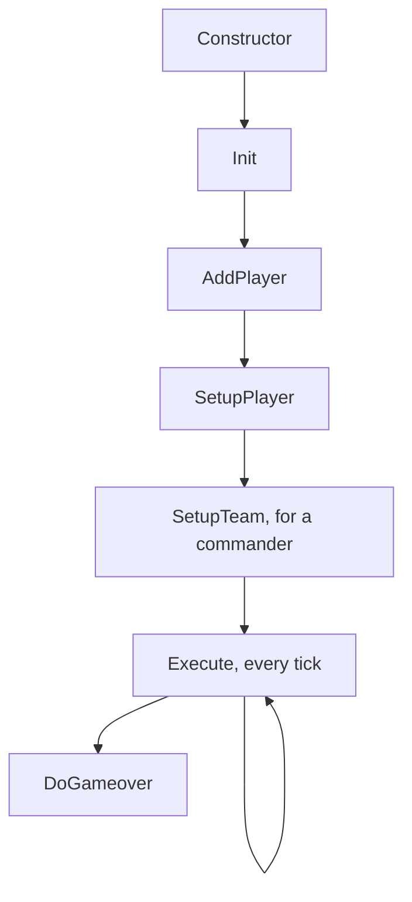
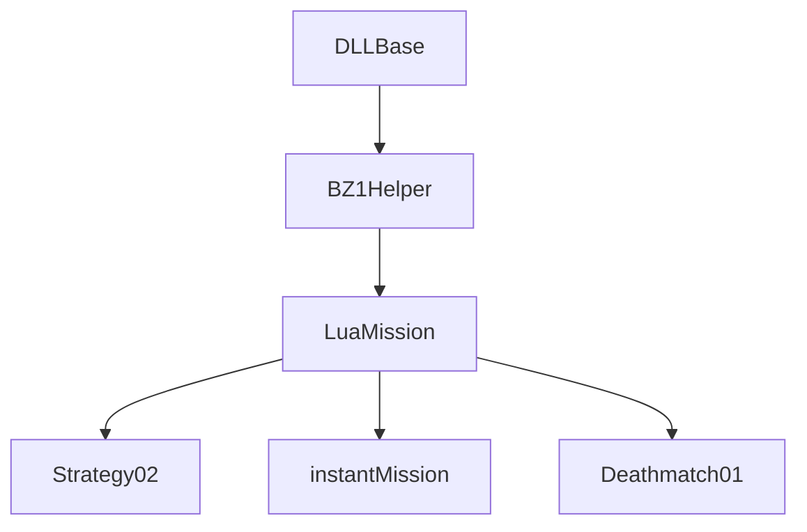
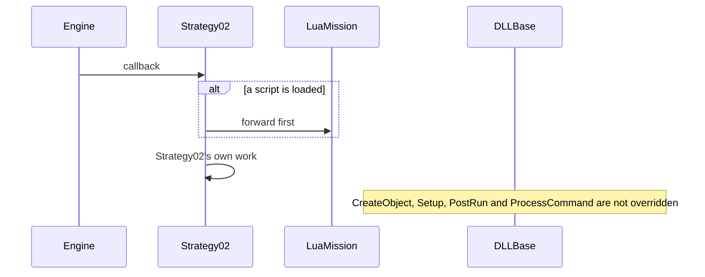
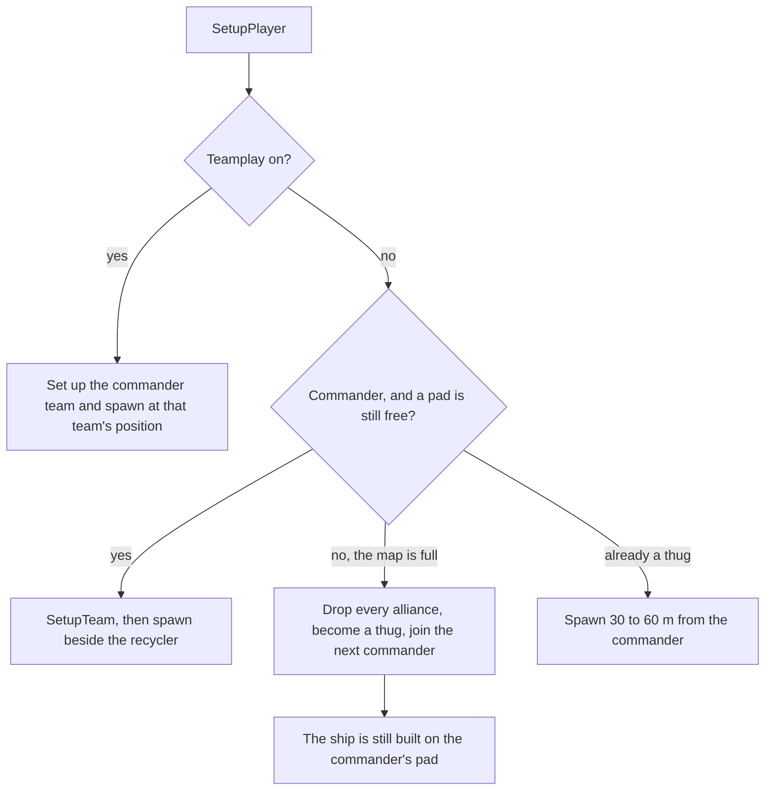
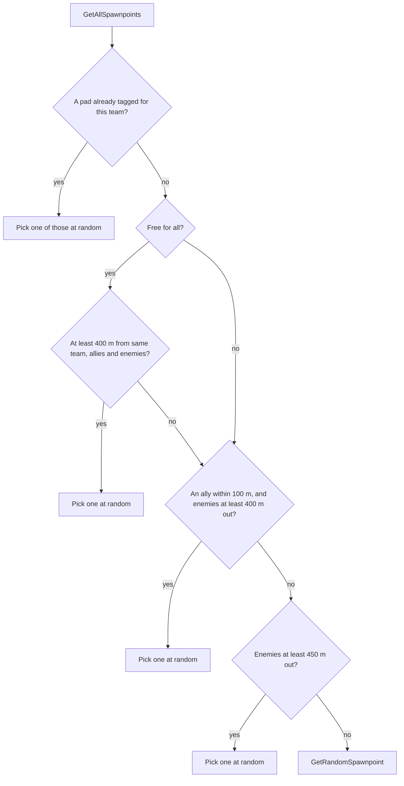
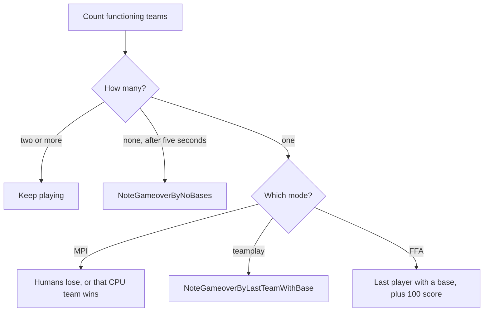
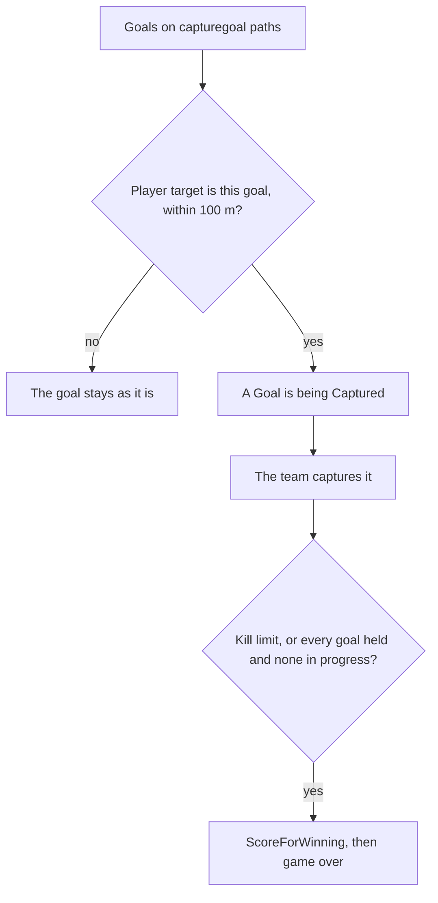
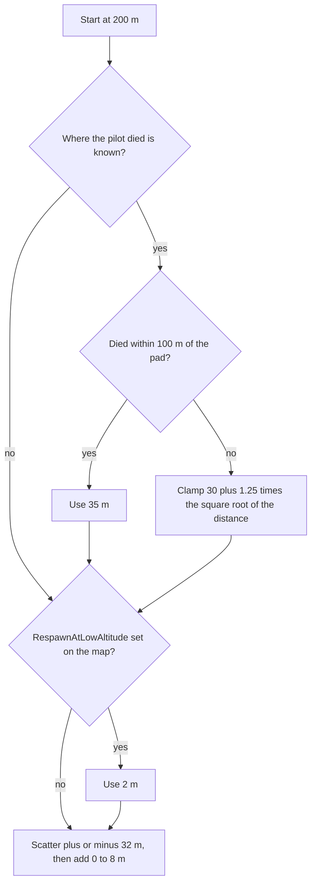

# BEHAVIOUR — what the VSR DLLs do

`NETVARS.md` says what the DLLs read from the lobby. This page says what they do with it: the class chain, every `Strategy02` function, the files under `shared/`, and each helper under `vsrcore/` with the ODF keys it reads. Read it before changing a file under `source/`. When a match does something odd, the [at-a-glance table](#at-a-glance) names the function that did it.

Trust tiers are in `../PROVENANCE.md`. Every number below was re-read on 2026-10-30 from the cited line. The tags are the ones `NETVARS.md` uses:

| Tag | Source | Tier |
|---|---|---|
| `P:<file>:<line>` | the ported source under `source/missions/{strategy02,shared,vsrcore,luamission}/` — behaviour-identical to the binary by the lockstep A/B for `Strategy02.dll` (`../STATUS.md`) | B |
| `D:<file> <orig lines>` | GBD's original source line range for a function, from the PDB (`reference/manifest/strategy02-attempt2/functions.tsv`) | B |
| `a2:<line>` | line in `reference/decompiled/strategy02-attempt2/src/missions/strategy02/strategy02.cpp.decomp.c` (other files named explicitly) | B |
| `G:<line>` | GBD's own C++ text of `Strategy02.cpp`, `original/lua/vsr_dll_lua_873669d/Lua/Strategy.lua` (lines 776-3652; `../STATUS.md` "GBD-text cross-check") | A |
| `Doc:<file>` | `original/docs/VSR Documents/<file>` | A |

The engine runs the DLL at `m_GameTPS` turns per second (20 on every VSR map; `BZCC_DEFAULT_TPS 20` in the SDK header). A tick is 50 ms. A time constant stored in turns is written as `TPS × seconds`.

**How to read an entry.** The first sentence is what a player would notice. The next line is the original range (`D:`) and the port range (`P:`). Each bullet ends with the lines that back it. A note callout is behaviour the binary shipped and the port keeps; the source marks those `// shipped:`.

A few words used throughout:

- A **commander** owns the recycler. A **thug** is an ally who does not.
- **MPI** is the one-human-side mode (`ivar12`). CPU teams then occupy slots from 6 upward.
- A team is **functioning** while its recycler or its factory still exists, or an ally's does.
- **ST:Capture** is game type 4 (`ivar53`).

## At a glance

A match is built once, then `Execute` runs every tick until something calls `DoGameover`.

| What you saw | Where it is decided |
|---|---|
| The recycler could not be hurt | [ExecuteRecyInvulnerability](#executerecyinvulnerability) (`ivar25`, minutes) |
| The CPU started with tanks or gun towers | [the MPI base spawn](#mpi-cpu-base-spawn) (force 1 and up) |
| Someone lost 500 score | [DeadObject](#deadobject), the spawn-kill rule |
| Scrap pieces vanished on their own | [scraphelper](#scraphelper) (1024 pieces, or 2048 objects on the map) |
| Scavenger income was paid twice | [utilityshiphelper](#utilityshiphelper) and the `ivar81` collision |
| The match ended because one base was left | [ExecuteCheckIfGameOver](#executecheckifgameover) |
| A pilot fell in from very high | [RespawnPilot](#respawnpilot) |
| "-- A Goal is being Captured" | [ExecuteST_Capture](#executest_capture) |
| "-- Aborting!" as the match started | [the asset check](#the-asset-check) |
| "WARNING: Too many objects on map!" | [scraphelper](#scraphelper) |

## 1. Class chain and the sizes the port must keep

`Strategy02.dll` is four classes deep. `Instant.dll` and `deathmatch01.dll` replace the top of the chain with `instantMission` / `Deathmatch01`. `LuaMission.dll` stops at `LuaMission`.

`DLLBase` (`shared/dllbase.cpp`) is the 1.3 mission base: default virtuals, and the `Mission` vtable trampolines. `SetWorld()` keeps `Missions[3]`, one mission per lockstep world. `BZ1Helper` (`vsrcore/bz1helper.cpp`) is GBD's helper framework: 17 helper objects, `TeamInfo[16]`, `MapInfo`, the resync diagnostics, the VSR asset check, and the multiplayer damage multiplier. `LuaMission` (`luamission/luamission.cpp`) loads `<map>.lua` and forwards every callback while a script is running. `Strategy02` (`strategy02/strategy02.cpp`) is the team, FFA, MPI and Capture strategy.

The sizes GBD's PDBs record are pinned by the 853 `static_assert`s of `source/missions/shared/vsr_layout_asserts.h` (QA gate 2).

| Class | Size |
|---|---|
| `DLLBase` | 0x4 |
| `BZ1Helper` | 0xA428 |
| `LuaMission` | 0xA458 |
| `Strategy02` | 0xECA4 |
| `instantMission` | 0xAC50 |
| `Deathmatch01` | 0xB544 |
| `BZ1Helper::TeamInfo` | 0xA14, times 16 |
| `BZ1Helper::MapInfo` | 0x48 |
| `SpawnpointInfo` | 0x24 |

| Helper record | Size |
|---|---|
| `ObjectClass` | 0x5C |
| `VehicleClass` | 0x54 |
| `BuildingClass` | 0x458 |
| `PowerClass` | 0x28 |
| `PowerupClass` | 0x104 |
| `PortalClass` | 0x390 |
| `TeleportTargetClass` | 0x14 |
| `AttacherClass` | 0x40C (the host, plus 8 times `AttacherTapClass` at 0x80) |
| `UtilityShipClass` | 0x2C |
| `ScrapClass` | 0x4 |
| `DispatchClass` | 0x148 |
| `UndeployClass` | 0x10 |
| `MorphObjectClass` | 0x148 |
| `CarrierClass` | 0x30 |
| `DroneClass` | 0x2C |
| `GravityInfo` | 0x14, times 16 |
| `AmbientAudioInfo` | 0x70, times 32 |

`Strategy02`'s own lists: `ThugScavengerClass` / `ThugPilotClass` / `MorphTankClass` / `CommBunkerClass` are 0x8, and `EmptyShipClass` is 0xC. `BuildMission()` is `new Strategy02`, which is `operator new(0xECA4)` (`a2:3922-3936`).

The `Strategy02` constructor (`D:strategy02.cpp 72-113`) sets `m_GameTPS = 20`, calls `EnableHighTPS`, `AllowRandomTracks(true)` and `TRNAllies::SetupTRNAllies(GetMapTRNFilename())`, and declares the save ranges `b_count 0x1BE, f_count 0x86, h_count 0x40, i_count 0xFF` with `i_array = &m_TotalGameTime` (`a2:45`). It then zeroes those four arrays and the restore-player buffers. The destructor (`D:115-117`) calls `CleanupTaunts`.

The engine entry is `GetMisnAPI` (`shared/dllbase.cpp`, `D:dllbase.cpp 377-402`): `misnExport.version = 0x4C89322E`, `VersionModifier = 'BAL1'` (`0x42414c31`), 18 import pointers copied, five `SetPre*Callback`s installed. There is no `CreateObject` / `Setup` / `PostRun` / `ProcessCommand` override in `Strategy02`. Those fall through to `LuaMission` / `DLLBase`.

Every `Strategy02` callback forwards to `LuaMission::*` first when `!StopScript` (a Lua script is loaded), then does its own work.

## 2. `strategy02.cpp` — the function table

Original line ranges (`D:`) and byte sizes come from the Strategy02 PDB (`reference/manifest/strategy02-attempt2/functions.tsv`). Decompile offsets (`a2:`) are into the attempt2 text. The two `BuildStartingVehicle` sizes, 120 and 115, are the PDB byte sizes of the path and vector overloads.

| Function | Original lines | Bytes | `a2:` | Section |
|---|---:|---:|---:|---|
| `ShouldRemoveThugScavengerObject` | 29-32 | 122 | | [predicates](#the-shouldremove-predicates) |
| `ShouldRemoveThugPilotObject` | 40 | 49 | | [predicates](#the-shouldremove-predicates) |
| `ShouldRemoveEmptyShipObject` | 50 | 42 | | [predicates](#the-shouldremove-predicates) |
| `ShouldRemoveMorphTankObject` | 58 | 35 | | [predicates](#the-shouldremove-predicates) |
| `Strategy02()` | 72-113 | 402 | | [section 1](#1-class-chain-and-the-sizes-the-port-must-keep) |
| `~Strategy02` | 115-117 | 301 | | [section 1](#1-class-chain-and-the-sizes-the-port-must-keep) |
| `Load` | 120-222 | 855 | | [Load](#load) |
| `PostLoad` | 225-255 | 143 | | [PostLoad](#postload) |
| `Save` | 258-315 | 539 | | [Save](#save) |
| `GetNextRandomVehicleODF` | 318-320 | 20 | | [entry](#getnextrandomvehicleodf) |
| `UpdateObjectives` | 323-329 | 51 | | [entry](#updateobjectives) |
| `AddObject` | 332-648 | 1472 | 426 | [entry](#addobject) |
| `DeleteObject` | 651-741 | 150 | | [entry](#deleteobject) |
| `SetCPUAIPlan` | 744-776 | 368 | | [entry](#setcpuaiplan) |
| `GetInitialPlayerPilotODF` | 786-830 | 420 | | [entry](#getinitialplayerpilotodf) |
| `GetInitialRecyclerODF` | 834-844 | 129 | | [entry](#getinitialrecyclerodf) |
| `GetSpawnpointForTeam` | 872-1006 | 749 | | [entry](#getspawnpointforteam) |
| `IsRecyclerODF` | 1011-1027 | 146 | | [entry](#isrecyclerodf) |
| `BuildStartingVehicle` (path) | 1033-1049 | 120 | | [entry](#buildstartingvehicle) |
| `BuildStartingVehicle` (vector) | 1053-1069 | 115 | | [entry](#buildstartingvehicle) |
| `SetupTeam` | 1082-1284 | 1966 | 1163 | [entry](#setupteam) |
| `SetupPlayer` | 1290-1630 | 2985 | 1417 | [entry](#setupplayer) |
| `Init` | 1634-1999 | 2626 | 1821 | [entry](#init) |
| `UpdateGameTime` | 2003-2074 | 379 | | [entry](#updategametime) |
| `ExecuteRecyInvulnerability` | 2078-2136 | 370 | 2300 | [entry](#executerecyinvulnerability) |
| `ExecuteCheckIfGameOver` | 2139-2426 | 1521 | 2369 | [entry](#executecheckifgameover) |
| `Execute` | 2429-3019 | 4819 | 2737 | [entry](#execute) |
| `AddPlayer` | 3022-3045 | 114 | | [entry](#addplayer) |
| `DeletePlayer` | 3048-3054 | 45 | | [entry](#deleteplayer) |
| `RespawnPilot` | 3058-3154 | 778 | 3577 | [entry](#respawnpilot) |
| `DeadObject` | 3158-3303 | 1024 | 3672 | [entry](#deadobject) |
| `PlayerEjected` | 3306-3323 | 79 | 3802 | [entry](#playerejected-objectkilled-objectsniped) |
| `ObjectKilled` | 3326-3345 | 98 | 3829 | [entry](#playerejected-objectkilled-objectsniped) |
| `ObjectSniped` | 3349-3368 | 84 | 3857 | [entry](#playerejected-objectkilled-objectsniped) |
| `PreGetIn` | 3424-3455 | 206 | 3881 | [entry](#pregetin) |
| `BuildMission` | 3459-3461 | 43 | 3922 | [section 1](#1-class-chain-and-the-sizes-the-port-must-keep) |
| `ScavengerManagementCode` | 3465-3604 | 586 | 3939 | [entry](#scavengermanagementcode) |
| `ExecuteST_Capture` | 3607-3859 | 2260 | 4069 | [entry](#executest_capture) |

`Strategy02::Execute` is the one function no Ghidra release decompiles cleanly. The received attempt2 text is the reference for it (`../STATUS.md` task 8).

Constants (`P:strategy02.cpp:17-60`). GBD's text has the same values (`G:` top of the C++ range; also the finished Lua port's header).

| Name | Value | What it is |
|---|---|---|
| `VEHICLE_SPACING_DISTANCE 20.0` | 20 m | how far the recycler is nudged off the spawn pad |
| `ScoreDecrementForSpawnKill 500` | 500 | score taken from a spawn killer |
| `ScoreForWinning 100` | 100 | score given to each winner |
| `MaxSpawnKillTime 15` | 15 s | how long after a spawn a kill still counts as a spawn kill |
| `RespawnDistanceAwayXZRange 32.0` | 32 m | sideways scatter on a pilot respawn |
| `RespawnDistanceAwayYRange 8.0` | 0 to 8 m | extra height scatter on a pilot respawn |
| `RespawnPilotHeight 200.0` | 200 m | default drop height |
| `AllyMinRadiusAway 30.0` | 30 m | nearest a thug or a CPU extra is placed |
| `AllyMaxRadiusAway 60.0` | 60 m | farthest a thug or a CPU extra is placed |
| `endDelta 10.0` | 10 s | delay from noticing game over to leaving the match |
| `FRIENDLY_SPAWNPOINT_MAX_ALLY 100.0` | 100 m | an ally must be closer than this for a "friendly" pad |
| `FRIENDLY_SPAWNPOINT_MIN_ENEMY 400.0` | 400 m | an enemy must be farther than this for a "friendly" pad |
| `RANDOM_SPAWNPOINT_MIN_ENEMY 450.0` | 450 m | an enemy must be farther than this for a "quiet" pad |
| `MAX_AI_TEAMS 5` | 5 | how many CPU teams MPI will create |

## 3. `Strategy02` — what each function does

### Starting and joining

#### Init

Reads the lobby and the map, allies the slots, and builds the local player. Capture maps also get their goals here.
`D:strategy02.cpp 1634-1999` · `P:strategy02.cpp:1339-1657`

- A non-empty `svar6` calls `StartingVehicleManager::Init()`. (`a2:1858-1861`)
- `svar0` is the map name. The DLL swaps the extension for `<map>.trn` and reads `[DLL] RespawnAtLowAltitude` (false), `FriendlySpawnpointMaxAllyRange`, `FriendlySpawnpointMinEnemyRange`, `RandomSpawnpointMinEnemyRange` (the three distance constants above), `CaptureTarget1..16` and `CaptureIsRandom` (false). `[VSR] MapAmbientSound` becomes `EasterEggSound = StartAudio2D(..., 44100 Hz, looped)`. (`P:1353-1378`)
- The netvar block is `NETVARS.md` §1–§2 in full. The reads, in order:

| Variable | Lands in | Clamp or scale |
|---|---|---|
| `ivar0` | kill limit | none means no limit |
| `ivar1` | time limit, in minutes | `× TPS × 60` when the clock starts (`a2:2168`) |
| `ivar7` | starting-vehicle mask | passed to `CreateVehicles` |
| `ivar12` | MPI | non-zero means MPI |
| `ivar13 / 96 / 97 / 98 / 99` | the five CPU races | only when MPI |
| `ivar21 / 22` | CPU turret skill, CPU other skill | clamp 0..3 |
| `ivar23 / 24` | human force, CPU force | clamp 0..3 |
| `ivar53` | game type | 4 is ST:Capture |
| `ivar54` | capture seconds | clamp 30..120, stored `× TPS` |
| `ivar14 / 15` | points for an AI kill, a kill for an AI kill | non-zero means on |
| `ivar16` | sniper respawn mode | see [GetInitialPlayerPilotODF](#getinitialplayerpilotodf) |
| `ivar32` | friendly fire | |
| `ivar55` | thug pilots may keep their team | |
| `ivar118` | spawn facing the map centre | |
| `ivar119` | restore players | clamp 0..2 |
| `ivar120` | pilot invulnerability, seconds | clamp 0..120, stored `× TPS` |
| `ivar121` | morph-tank auto-deploy | clamp 0..3 |
| `ivar17 / 18` | human turret skill, human other skill | clamp 0..3 |
| `ivar25` | recycler invulnerability, minutes | `× 60 × TPS` (`a2:2158-2159`) |

- The fifteen-slot alliance loop runs only when `!IsTeamplayOn() || m_IsMPI`. Slot `k` reads `ivar35+k → m_AllyTeams[k+1]` (a value below 1 becomes the slot's own index) and `ivar81+k → m_ThugFlag[k+1]` (clamped 0..1). (`P:1483-1496`)
- In MPI teamplay the humans are one alliance: teams 1 through 5 are allied, and their colours are put back afterwards. (`P:1499-1525`)
- Every alliance is given a commander. If nobody in it has the thug flag clear, the first player in the alliance is promoted. (`P:1547-1575`)
- On the server, or offline, the clock starts, taunts are armed when the game is MPI, and the local player is built through `SetupPlayer`.

Capture setup (`P:1610-1651`), when the game type is 4. For every path named `capturegoal%d`, up to 16 goals, the DLL picks a `CaptureTarget`. The pick is `floor(GetRandomFloat(N))`, clamped to `N`, when `CaptureIsRandom` is set. Otherwise it walks the list and wraps to 0. It `BuildObject`s that ODF on team 0 at the path, calls `SetObjectiveOn`, and counts it. Otherwise the console gets `Error: Map has no Capture ODF's set!` or `Error: ODF '%s' doesn't exist!`.

#### Load

Restores the DLL's own save blob. A mission save (the engine's quick-save path) only clears the arrays and returns.
`D:120-222` · `P:125-225`

- Forwards to `LuaMission` first, then turns high TPS back on and calls `SetAutoGroupUnits(false)`.
- When this is not a mission save, it also calls `StartingVehicleManager::Load` and `WantBotKillMessages`.
- A mission save zeroes the bool, float, handle and int arrays and returns without reading the blob.
- A real load reads the thug-scavenger, thug-pilot and empty-ship lists, then those four arrays, then the restore-player block: ship ODF, pilot ODF, name, ship weapons, pilot weapons, pilot ammo, matrix, velocity, omega, the ambient-sound name and the empty-ship ODFs.
- MPI re-inits taunts. If init has already run and the ambient file exists, the map music is restarted. `UpdateObjectives` runs either way.

#### PostLoad

Turns saved handles back into live ones.
`D:225-255` · `P:227-254`

- Forwards to `LuaMission`. A mission save returns immediately.
- `ConvertHandles` runs on every thug scavenger, thug pilot and empty ship, then on the handle array.

#### Save

Writes the same blob `Load` reads. A mission save returns without writing it.
`D:258-315` · `P:256-312`

- Forwards to `LuaMission`, then `StartingVehicleManager::Save`.
- Writes the three lists, the four arrays, and the restore-player block, in the same order `Load` reads them.

#### AddPlayer

Builds a player who joins after the match has started.
`D:3022-3045` · `P:2483-2509`

- Forwards to `LuaMission`. If `Init` has not run, this call runs it.
- A player the engine already knows about returns immediately. A genuinely new player in MPI gets `DoTaunt(TAUNTS_NewHuman)`.
- A new player is built with `SetupPlayer`, then `SetAsUser` and `AddPilotByHandle`. The function returns true.

#### DeletePlayer

Announces a departure. It does not tear the base down; [ExecuteCheckIfGameOver](#executecheckifgameover) does that when the buildings are gone.
`D:3048-3054` · `P:2511-2518`

- Forwards to `LuaMission`. In MPI it plays `DoTaunt(TAUNTS_LeftHuman)`.

### Setting up a base

#### SetupPlayer

Builds one player's ship, and the team's base if this player is a commander who still has a pad.
`D:1290-1630` · `P:1058-1336`

- Teamplay commanders (`!m_ThugFlag[Team]`) get `SetupTeam` and spawn next to their recycler while `NumCommanders < m_NumSpawnPoints`.
- When the map has no base slot left, the player is converted to a thug (`UnAlly` from every team, `m_ThugFlag[Team] = true`) and cycled onto the next commander team (`P:1080-1145`).

> [!NOTE]
> The converted player is still built at the commander position. Only the saved respawn point moves out to `AllyMinRadiusAway..AllyMaxRadiusAway`. The port keeps this, as shipped (`../STATUS.md` row).

- Thugs who were already thugs spawn `AllyMinRadiusAway..AllyMaxRadiusAway` from their commander. With `ivar118` set, that offset is 50 m toward the map centre, stepped by 15 degrees per thug.
- Restore-players (`ivar119`, `P:1223-1299`) puts a saved ship back when a snapshot matches. Mode 1 matches the player name. Mode 2 matches the team. The restored ship gets its saved ODF, pilot, weapons, ammo, health, matrix, velocity, omega, scavenger scrap and deploy state. Camera pods (`vcamr_vsr`) always take the plain respawn.
- A player named `Krohonus_Legs`, on the plain path, is built as `evlegs_vsr` instead of the lobby vehicle. (`P:1307-1308`)
- Otherwise the ship is the lobby vehicle. Then `SetPilotClass(..., GetInitialPlayerPilotODF(race, team, false))`, facing the map centre when `ivar118` (`P:1316-1327`). Team 0 is `MakeInert` (`P:1332`).

#### SetupTeam

Builds a commander's recycler, starting vehicles and scrap. It runs once per commanding team. In FFA that means once per commander; in teamplay, once for the defending team of an alliance.
`D:1082-1284` · `P:897-1053`

- `DoTaunt(TAUNTS_GameStart)` for team 1 in MPI. (`P:905`)
- The spawn point in MPI is the path `Player_%d` (`m_PlayersSpawned + 1`) via `GetPathPoints`. Otherwise, and when that position is the null vector, it is `GetSpawnpointForTeam` (`P:917-930`). The dot-product test that detects the null vector exists only inside the MPI branch (decompile `a2:1227-1266`; `../STATUS.md` cross-check item 7).
- That position is stored in `m_TeamPos[3*Team..]`.
- The recycler is `GetInitialRecyclerODF` (`svar5`, list 2, default `ivrecy_m`, `a2:841-849`), placed with `GetPositionNear(pos, 20, 40)` and `SetRandomHeadingAngle`, unless `ivar118` is set, in which case it sits on the pad facing the map centre. A recycler already in the team slot is left alone. The team then gets `SetScrap(Team, 40)` (`P:994`).
- `startingVariant` comes from the recycler ODF's `[GameObjectClass] startingVariant`, following `classlabel`. Failing that, it is the text after the last `_` in the recycler name, and after the second `_` when the name has two. (`P:960-991`)
- `StartingVehicleManager::CreateVehicles(Team, race, startingVariant, ivar7 mask, pos)` builds the lobby starting force. Skill is dropped while those vehicles are created.
- Every player on a teamplay team gets `GetInitialPlayerPilotODF(race, team, false)` (`P:1002`). Each allied team's `m_TeamPos` is set at `GetPositionNear(pos, 30, 60)` (`P:1006-1043`), or on the same pad when spawn-facing-centre is on.

#### GetSpawnpointForTeam

Picks a pad for a commander. A pad that already belongs to the team wins. After that the DLL prefers a pad near friends and far from enemies, then any quiet pad, then a random one.
`D:872-1006` · `P:700-828`

- `GetAllSpawnpoints(Team)` fills the list. An empty list returns the zero vector.
- The friendly tier wants `DistanceToClosestAlly < FriendlySpawnpointMaxAllyRange` (100), or the same for the same-team distance, and `DistanceToClosestEnemy > FriendlySpawnpointMinEnemyRange` (400). The code tests enemy distance with `>=`.
- The quiet tier wants `DistanceToClosestEnemy > RandomSpawnpointMinEnemyRange` (450), again `>=` in the code.
- Each tier picks at random. The last resort is `GetRandomSpawnpoint`, not "any remaining pad".

> [!NOTE]
> In FFA the distance fields are read from the wrong query. `SameTeam` comes from the alliance query and `Ally` / `Enemy` come from the team query. The port keeps this, as shipped (`../STATUS.md` row). The 400 m test on that pass uses `m_FRIENDLY_SPAWNPOINT_MIN_ENEMY` for all three distances.

#### GetInitialRecyclerODF

The recycler's ODF name for a race.
`D:834-844` · `P:660-673`

- `svar5` through the recycler list. An empty string falls back to `ivrecy_m`. Byte 0 is then overwritten with the race character, so `ivrecy_m` becomes `fvrecy_m` for an ISDF-style `f`, and so on. (`a2:841-849`)
- Three siblings sit beside it and nothing else in the port calls them: a scavenger `ivscav` (`P:676`), a constructor `ivcons` (`P:684`) and a healer `ivserv` (`P:692`). `GetInitialPlayerVehicleODF` just returns `GetPlayerODF`. (`P:606`)

#### IsRecyclerODF

A free function. Returns the race character of a recycler, or 0.
`D:1011-1027` · `P:832-848`

- Accepts `CLASS_RECYCLERVEHICLE`, `CLASS_RECYCLER` and `CLASS_RECYCLERVEHICLEH`, the same three `IsRecycler(h)` accepts, and returns the ODF name's first character.

#### BuildStartingVehicle

Builds one starting unit, preferring the first ODF name when that file exists.
`D:1033-1049` · `D:1053-1069` · `P:853-886`

- Both overloads copy `ODF1`, write the race into byte 0, and fall back to `ODF2` the same way when the file is missing. One takes a path name, the other a position.
- `SetGroup` runs only when `aGrp >= 0`.

> [!NOTE]
> Every caller passes `aGrp = -1`, so the `SetGroup` branch is absent from the binary. See [the lessons](#8-lessons-from-the-port).

### Each tick

#### Execute

One tick of the match: clocks, game-over checks, the per-player bookkeeping, and, once, the MPI computer bases.
`D:2429-3019` · `P:2066-2481`

The order inside the function is the order below, which is not the order the names appear in the header. `UpdateGameTime` runs after the game-over check, not before it.

1. Forward to `LuaMission` when a script is loaded. Run `Init` if it has not run.
2. `ExecuteRecyInvulnerability`.
3. `ExecuteCheckIfGameOver`.
4. `UpdateGameTime`.
5. `ExecuteST_Capture` when `m_GameType == 4`.
6. The per-player pass.
7. Empty-ship invulnerability (`P:2232-2252`) and the morph-tank auto-deploy pass (`P:2256-2271`).
8. `ScavengerManagementCode` when `!teamplay || MPI`.
9. The MPI CPU base spawn, once (`P:2278-2436`), and the MPI scrap trickle (`P:2440-2478`).

Per player, every tick:

- Pilot invulnerability counts down while this player is the protected pilot. Firing (current ammo below maximum) ends it immediately, and so does the timer. Health is then restored. (`P:2098-2108`)
- Camera pods `vcamr_vsr` get `SetPerceivedTeam 0` and are un-allied from everyone (`P:2121-2123`). Leaving the pod puts the alliances back (`P:2135-2151`).
- The restore-players snapshot is taken every tick for ships that are not pods and not `vsatview_vsr` (`P:2154-2209`): ODF, pilot, weapons, ammo, health, position, velocity, omega, scavenger scrap and deployed state.

##### MPI CPU base spawn

Once, MPI builds a computer base for each CPU race that fits on the map.
`P:2278-2436`

- `MaxAI_Teams = m_NumSpawnPoints − numCommanders`. Teamplay uses `− 1` instead of subtracting the commanders. The result is capped at `(MAX_TEAMS−1) − PlayerLimit` and at 0..5.
- CPU teams start at 11. A race of 0 is skipped. The recycler comes from `svar12` (list 2, default `%cvrecycpu_vsr`) and is built at `Enemy_%d` unless one is already in the team slot. A pre-placed recycler keeps its own race, via `IsRecyclerODF`.
- The new base gets `SetScrap 40`, `SetCPUAIPlan(team, team−5)`, `SetTeamNameForStat("Computer Team %d")`, a `startingVariant` read the same way as in `SetupTeam`, and `CreateVehicles`.
- The force extras use `x` = 0..4 as a counter (`P:2397-2424`). Positions that are not on a path use `GetPositionNear(recycler, 30, 60)`.

| Force | Units | Where |
|---|---|---|
| always | 1 × `%cvscav%s` and 2 × `%cvturr%s` | near the recycler |
| 1 and up | 2 × `%cbspir%s`, falling back to the turret, and 2 × `%cvsent%s`, falling back to the scout | gun towers on `%dgtow1..2`, sentries near the recycler |
| 2 and up | one more sentry, 2 more gun towers, and 3 × `%cvtank%s` | gun towers on `%dgtow3..4`, the rest near the recycler |

- When the slot count is exceeded the console and the message box get `ERROR: CPU %d (Team: %d) spawn skipped: Too many possible Humans (%d) for map Spawns (%d)…`. The rest of that sentence asks the host to lower the player limit or the number of commanders.

##### MPI scrap trickle

While MPI is running, scrap arrives on its own.
`P:2440-2478`

CPU teams (6..15) get `+1` scrap every `TPS × 3 / × 2 / × 1 / ÷ 5` turns for force 0..3, and additionally every `TPS × {10, 9, 8, 7, 6} / 10` turns for 1..5 humans. Human teams get `+1` every `TPS × 10 / × 8 / × 6 / × 4` turns for `m_HumanForce` 0..3 when it is non-zero.

| Who | Force | Base interval | Extra |
|---|---|---|---|
| CPU teams 6..15 | 0 | `TPS × 3` | the force-0 branch is in the source, and the outer test skips it |
| CPU teams 6..15 | 1 | `TPS × 2` | plus the human-count row below |
| CPU teams 6..15 | 2 | `TPS × 1` | plus the human-count row |
| CPU teams 6..15 | 3 | `TPS / 5` | plus the human-count row |
| CPU, with 1..5 humans | | `TPS × {10, 9, 8, 7, 6} / 10` | a second `+1`. Six or more humans skip this extra |
| every other team | 0..3 | `TPS × 10 / × 8 / × 6 / × 4` | only when `m_HumanForce` is non-zero, so the 0 row never pays |

#### UpdateGameTime

Advances the clock and fills the timer box.
`D:2003-2074` · `P:1660-1730`

- The box shows `[mission] "Time Left %d:%02d[:%02d]\n"` when a time limit is set, and `"Mission Time %d:%02d[:%02d]"` otherwise, through `SetTimerBox` (`P:1680-1727`). An hour or more is shown as hours, minutes and seconds. Under an hour the hours field is left off.
- At zero remaining, `NoteGameoverByTimelimit(); DoGameover(endDelta)` (`P:1704`).

#### ExecuteRecyInvulnerability

Keeps every set-up recycler at full health until `ivar25` runs out, and counts the time down on screen.
`D:2078-2136` · `P:1733-1789`

- While `m_RecyInvulnerabilityTime > 0` (`ivar25` minutes `× 60 × TPS`, `a2:2158-2159`), every tick calls `SetCurHealth(recycler, GetMaxHealth(recycler))` for each set-up team. A missing handle falls back to slot 1 through `DLLUtils::IsRecycler`.
- The `[strat] recyclersVulnerable / invulnerableExpiresMin / invulnerableExpiresSec` lines are posted every 60 s, and every 15 s inside the last minute, in colour `0xFFFF00FF` (`P:1773-1784`).

#### ExecuteCheckIfGameOver

Ends the match when fewer than two sides still have a base.
`D:2139-2426` · `P:1792-2064`

A team is functioning when its recycler (the vehicle, or `GetObjectByTeamSlot(team, 1)`) is alive, or its factory (`slot 2`) exists, or an allied team's does. The respawn anchor `m_TeamPos` is re-noted when `(m_ElapsedGameTime & 0xFF) == 0` (`P:1855`).

- Two or more functioning teams: return.
- None, after `TPS × 5`: `NoteGameoverByNoBases(); DoGameover(endDelta)` (`P:1937-1941`).
- One team, MPI: `"All Human bases destroyed!"` (`P:1924`) when the humans are gone, or `"Computer Team %d has won, destroyed all enemy bases."` when a CPU team is the last one.
- One team, teamplay: `NoteGameoverByLastTeamWithBase(WhichTeamGroup(i))`.
- One team, FFA: `NoteGameoverByLastWithBase(player)`. With allies, the `[Network] HitLastWithBaseStr` message is built but never shown (`P:2025-2028`).
- Winners get `+ScoreForWinning` (100) each (`P:2032, 2045, 2055`), then `DoGameover(endDelta)`.
- A recycler dying plays `TAUNTS_CPURecyDestroyed` or `TAUNTS_HumanRecyDestroyed` (`P:1964-1966`).

> [!NOTE]
> `HitLastWithBaseStr` is formatted and then discarded. The port keeps that, as shipped.

#### ExecuteST_Capture

Watches the goals built in `Init` and ends the match when one side holds all of them, or hits the kill limit.
`D:3607-3859` · `P:2924-3163`

- Goals live at paths `capturegoal%d`.
- A capture starts when that team's player has the goal as their target, is within 100 m, and the goal is neutral or held by an enemy. Two unallied players both inside 100 m of the same goal cancel the timer. (`P:2973-3010`)
- A dead goal is removed and the arrays are shifted down (`P:2952-2965`).

> [!NOTE]
> After that shift, the rest of the pass runs on the previous slot. The port keeps the `x--`, as shipped.

- The messages are `-- A Goal is being Captured by %s!`, `-- %s Captured a Goal [from %s]!`, `-- %s has won! Captured All Goals!` / `Captured %d Goals!`, `-- Team %d has won! …`, and `-- No Capture Goals! Game will be over very soon!`.
- The winner is whoever reaches the `ivar0` score, or the team that holds every goal, allies counting, with none still being captured (`P:3094-3110`).
- That pays `+ScoreForWinning`, then `NoteGameoverByScore` or `NoteGameoverWithCustomMessage`, then `DoGameover(endDelta)`.
- The objective file is `mpobjective_stcap.otf` in this mode and `mpobjective_st.otf` otherwise (`UpdateObjectives`).

#### ScavengerManagementCode

In FFA and MPI, a thug's scavenger pays its scrap to the commander, and a thug pilot eventually joins the commander's team.
`D:3465-3604` · `P:2858-2920`

- Runs only when teamplay is off, or the game is MPI. `Execute` is what enforces that.
- Thug scavengers pay their held scrap to the commander team, up to `GetMaxScrap`. The remainder stays on the scavenger (`SetScavengerCurScrap`, `P:2874-2892`). A deployed thug scavenger is re-teamed to the commander.
- Thug pilots are re-teamed to the allied non-thug team when their `SwitchTickTimer` runs out (`P:2899-2918`). The timer is armed at `TPS × 15` in `AddObject`.

### Objects arriving and leaving

#### AddObject

Files each new object into the list that will manage it, and applies the one-shot rules (scrap wipe, skill, empty ships, morph tanks, comm bunkers).
`D:332-648` · `P:328-542`

- Forwards to `LuaMission` when a script is loaded. An ODF name with a `:suffix` is cut back to the base name when the suffixed file does not exist.
- `ivar117` at tick 0 removes every `CLASS_SCRAP` (`P:354`). An out-of-bounds `CLASS_NAVBEACON` is removed (`P:373`). MPI CPU objects are `AddToDispatch(h, 15.0, false, 0, false)` (`P:365`).
- `SetSkill` uses the turret or non-turret skill of the owner's side. `CLASS_TURRETTANK` decides which skill (`P:389-391`).
- `CLASS_SPAWNBUOY` counted at tick 0 becomes `m_NumSpawnPoints` (`P:394`).
- Recycler handles are recorded (`CLASS_RECYCLER*`). `[FactoryClass] buildEmptyItem` (0) together with `BuildItem%d` gives the empty-ship ODF for that team (`P:410-415`).
- Thug scavengers (`CLASS_SCAVENGER/H`) and thug pilots (`CLASS_PERSON`, switch timer `TPS × 15`) are listed for `ScavengerManagementCode`.
- Empty ships get `SetMaxHealth(h, 0)` for `m_PilotInvunerability` turns, so a freshly bailed ship cannot be finished off during the grace period.
- `CLASS_MORPHTANK` is auto-deployed with `SetCommand(h, CMD_CLOSE + ivar121)` when `ivar121 > 0` (`P:494`).
- `CLASS_COMMBUKNER` (sic) and `CLASS_COMMTOWER` take base slots (`P:522`).

#### DeleteObject

Stops a restored player's corpse from dropping scrap, and hands a dead comm bunker's base slot to another bunker that shared it.
`D:651-741` · `P:544-574`

- Forwards to `LuaMission`.
- When restore-players is on, the object is a player, and that team no longer has a player handle, the object is flagged `SetNoScrapFlagByHandle`.
- If the object was a comm bunker, another bunker recorded with the same base slot gets `ResetTeamSlot`.

#### The ShouldRemove predicates

Small filters the list sweeps pass to `std::remove_if`. The first four have their own PDB symbols. `ShouldRemoveCommBunkerObject` lives in the port header and has no separate PDB entry.
`D:29-32` and the following rows of the [function table](#2-strategy02cpp-the-function-table) · `P:strategy02.h:172-179`

| Predicate | Removed when |
|---|---|
| `ShouldRemoveThugScavengerObject` | the object is gone, or it has turned into `CLASS_EXTRACTOR` or `CLASS_SILO` |
| `ShouldRemoveThugPilotObject` | the object is gone, its `SwitchTickTimer` has gone negative, or a player is now driving it |
| `ShouldRemoveEmptyShipObject` | the object is gone, or `GetMaxHealth` is back above 0, which means the grace period ended |
| `ShouldRemoveMorphTankObject` | the object is gone, or the deploy command has been sent |
| `ShouldRemoveCommBunkerObject` | the object is gone |

### Death and scoring

#### DeadObject

Scores a death, checks the kill limit, and either respawns a pilot or ejects one.
`D:3158-3303` · `P:2620-2762`

Team 0, powerups and `CLASS_TORPEDO` return `DoEjectPilot` immediately and score nothing (`P:2629-2636`). Everyone else is scored from `cost = GetActualScrapCost(dead)`. Capture mode (`m_GameType == 4`) skips the score columns and still applies kills, deaths and the spawn-kill penalty.

| Situation | Kills | Deaths | Score |
|---|---|---|---|
| Dead player | | `AddDeaths +1` when they died as a person (`P:2656-2658`) | `AddScore(dead, −floor(cost/20))` |
| Dead AI | | `AddDeaths +1` under `ivar15` | `AddScore(dead, −floor(cost/20))` under `ivar14`, unless Capture (`P:2663-2666`) |
| Human killer, same or allied team, not a suicide | `AddKills −1` | | `AddScore −floor(cost/10)`, unless Capture |
| Human killer, suicide | none | | none |
| Human killer, enemy | `AddKills +1` | | `AddScore +floor(cost/10)`, unless Capture (`P:2677-2691`) |
| AI killer, same or allied | `AddKills −1` under `ivar15` | | `AddScore −floor(cost/10)` under `ivar14`, unless Capture |
| AI killer, enemy | `AddKills +1` under `ivar15` | | `AddScore +floor(cost/10)` under `ivar14`, unless Capture (`P:2699-2709`) |
| Spawn kill | | | `AddScore(killer, −500)` |

A spawn kill is a killer who is not the victim, a human victim, victim team 1..15, `m_SpawnedAtTime[team] > 0`, and `elapsed − spawnedAt < TPS × 15`. The message is `"Spawn kill by %s on %s\n"` (`P:2717-2730`). The kill limit then checks `NoteGameoverByKillLimit; DoGameover(10.0)` (`P:2734-2737`).

A dead person is `RespawnPilot` when they were human. A dead AI person returns `DLLHandled` (a snipe the DLL has finished). Anything that is not a person returns `DoEjectPilot`. An MPI human ship on teams 1..10 also plays the "ship destroyed" taunt.

#### RespawnPilot

Puts a dead player's pilot back in the air above their base, high enough that the same shot cannot kill them twice.
`D:3058-3154` · `P:2520-2617`

- Spawns at `m_TeamPos[team]`, or `GetSafestSpawnpoint` when the team number is out of range, and sets `m_SpawnedAtTime[team]`.
- Height starts at 200. With a victim position, `d = dist2D(victim, spawn)`: `d < 100` gives 35, otherwise `clamp(30 + √d × 1.25, 40, 70 + 15 × CountAlliedPlayers(team))` (`P:2545-2569`). `RespawnAtLowAltitude` forces 2.0 (`P:2574`).
- The pad is then jittered by ± 32 m in X and Z, held at least 2.5 m above the floor, and given another 0..8 m of height (`P:2578-2593`).

- The pilot ODF is `GetInitialPlayerPilotODF(race, team, true)` (`P:2595`).
- Pilot invulnerability, when `m_PilotInvunerability` is set, saves the real maximum and calls `SetMaxHealth(h, 0)` for that many turns.
- Then `SetAsUser`, `AddPilotByHandle`, `SetRandomHeadingAngle`. Team 0 is `MakeInert`. The return is `DLLHandled`: the DLL has built the replacement.

#### GetInitialPlayerPilotODF

Chooses the pilot ODF for a first spawn or a respawn. The recycler's ODF can name both.
`D:786-830` · `P:613-657`

- For a team above 0, teamplay first resolves `GetCommanderTeam`. The recycler ODF is opened, and its `classlabel` parent is opened too.
- The key is `[GameObjectClass] PilotRespawnWithSniper` when this is a first spawn and `ivar16` is below 2, or a respawn and `ivar16` is 1. Every other case reads `PilotRespawnWithOutSniper`. In words: 0 starts with a sniper and respawns without one, 1 uses a sniper both times, 2 uses neither.
- A missing file, and team 0, fall back to `%cspilo` or `%csuser_m` with the race written into byte 0. A missing fallback prints `ERROR: '%s' does not exist. Giving you pilot DEFAULT ISDF! FIX IT!` and forces the race byte to `i`.

#### PlayerEjected, ObjectKilled, ObjectSniped

Three engine callbacks, one scoring function. Each forwards to `LuaMission` first.
`ObjectKilled` and `ObjectSniped` act only in world 0 and route into `DeadObject`. `PlayerEjected` does the same after rejecting team 0.

- `PlayerEjected` (`D:3306-3323`, `P:2774`) returns `DLLHandled` for team 0. Bailing out counts as a death to yourself: `DeadObject(h, h, false, !IsPlayer(h))`.
- `ObjectKilled` (`D:3326-3345`, `P:2777-2791`) returns `DoEjectPilot` outside world 0. In world 0 it calls `DeadObject` with `IsPerson` and `!IsPlayer`.
- `ObjectSniped` (`D:3349-3368`, `P:2793-2806`) returns `DLLHandled` outside world 0. In world 0 the victim is always passed as a dead person, so a snipe respawns a pilot instead of ejecting one.

#### PreGetIn

Last word on a pilot entering an empty craft, after the engine has already checked that the craft is empty and the masks match.
`D:3424-3455` · `P:2818-2848`

- World 0 only. Any other world returns `PREGETIN_ALLOW` without changing teams. The Lua result is taken first.
- An allied AI pilot entering an empty craft is re-teamed to the craft (`SetTeamNum`) unless `ivar55`.
- Pilot invulnerability is released (`SetMaxHealth` restored to the saved maximum).
- In MPI a craft on a team above 10 is `AddToDispatch`ed (`P:2845`).

### Plans and objectives

#### SetCPUAIPlan

Picks the AIP file for a CPU team, and taunts the first time the plan changes.
`D:744-776` · `P:577-603`

- The name is `"%s%c%d_%d.aip"`: `CustomAIPNameBase` (`svar3` through `GetCheckedNetworkSvar`, default `"VSR_"`, `a2:722-731`) plus the race, plus `(team − 5)`, plus `rand(0..2)`. A missing file falls back to `"%s%c%d_0.aip"`.
- `DoTaunt(TAUNTS_Random)` plays on a later change, not on the first assignment (`P:600`).

#### UpdateObjectives

Swaps the on-screen objective text for the game mode.
`D:323-329` · `P:319-326`

- Clears the list. Game type 4 adds `mpobjective_stcap.otf`. Anything else adds `mpobjective_st.otf`. Both use white, and a display time of −1, which means "do not pop the objective window just to show this".

#### GetNextRandomVehicleODF

The engine asks for a random vehicle. Strategy hands back whatever the lobby already chose for that team.
`D:318-320` · `P:314-317`

- Returns `GetPlayerODF(Team)`.

## 4. `shared/` — the 1.3 files VSR kept

These are the Battlezone 1.3 mission files VSR still compiles. Each one does a small job the strategy calls by name.

### `dllbase.cpp`

The mission base class, and the free functions the engine actually calls.
`D:1-402`

- Default virtuals, and free-function trampolines through the `Mission` vtable.
- `SetWorld` keeps `Missions[3]`, one per lockstep world.
- `GetMisnAPI` is the export described in [section 1](#1-class-chain-and-the-sizes-the-port-must-keep).

### `dllutils.cpp`

Three small queries the strategy and the helpers share.

- `IsRecycler(h)` accepts `CLASS_RECYCLER`, `CLASS_RECYCLERVEHICLE`, `CLASS_RECYCLERVEHICLEH`.
- `CountAlliedPlayers(team)` counts players on teams 1-15 who are allied with that team.
- `GetCheckedNetworkSvar(listType, n)` reads a network string and checks it against the named list.

### `startingvehicles.cpp`

Turns the lobby's starting-force mask into vehicles beside the recycler.

- `Init()` copies up to 32 entries of `NETLIST_StratStarting` into `s_StartingVehicleList[32][64]`.
- `CreateVehicles(Team, Race, Variant, Bitmask, Where)` walks each set bit of the `ivar7` mask. Entry `i` gets `[0] ← race` and the `startingVariant` suffix, or the bare name when the suffixed ODF does not exist. Each one is built at `GetPositionNear(Where, 30, 60)` and passed to `SetBestGroup`.

### `taunts.cpp`

CPU chatter. Compiled into `VSRCore.lib`. The lines themselves live in `.otf` files, not in the DLL.

- `InitTaunts` reads `.trn [DLL] TauntODFFile` (default `"Taunts"`), then `<name>.odf [TauntCategories] Category0..N`, then the lines of `<name><Category>.otf` into `TauntList[16]`.
- `DoTaunt` has a 5% chance of picking the random category, never repeats the line it just said, and prints `"%.255s : %.*s\n"` with the CPU team name (`svar2`, default `"Team Computer"`). At most one taunt every `TPS × 20` turns, and only when `options.play.taunts` is on.

### `trnallies.cpp`

Alliances written into the map file.

- `SetupTRNAllies(trn)` reads `[DefaultAllies] Entry1..N`. Each entry is `"A_B"`, and each one calls `Ally(A, B)`.

### `pupmgr.cpp` and `trace.cpp`

`pupmgr.cpp` (deathmatch01 only) and `trace.cpp` are the 1.3 files unchanged (`../STATUS.md`).

## 5. `vsrcore/` — the helper framework

`Add<X>Object(handle, …)` reads that object's ODF keys at `BZ1Helper::AddObject` time and stores them on a per-object record. `Execute(bz1)` then runs once per tick from `BZ1Helper::Execute`, in this order (`P:bz1helper.cpp:1181-1196`). Object is the step that drives Portal for anything flagged `CanTeleport`. Portal runs again later for the portals themselves.

### Resync diagnostics

Every helper's `PostLoad` converts handles. On a resync it compares its list with the `Temp<X>Buffer` the other machine sent, and logs the first member that differs. The strings are `<X>LIST MISMATCH` and `TEAMINFO MISMATCH: …`, about 70 of them. The lockstep A/B reads those logs.

### bz1helper

The object that owns the helpers, the team table, the asset check and the multiplayer damage rule.

#### Constructor

Allocates the 17 helpers and opens the log.
`P:bz1helper.cpp:55-160`

- Reads `.trn [World] WorldLetter`.
- Reads `[DLL] MPISwitchTeams%d` entries (`"A_B"`) when `ivar53 == 2 || ivar12 == 1 || options.instant.awarev13`.
- `Logging = ivar115 || civar5`.
- `m_GameVersion = 20185` (`P:146`). `PatchData.txt [VersionInfo] Version` becomes `m_ModVersion` (`P:148-149`).
- The log file is `VSR_<date>.log` (`P:152`). The banner is `PrintConsoleMessage("VSR BZCC DLL Created by General BlackDragon")` (`P:156`).
- `IFace_Exec("vsrbasesetup.cfg")` runs when that file is present (`P:157-158`).

#### BZ1Helper Init

Reads the map size, gravity and the reinforcement distances, then the netvars every DLL shares.
`P:1371-1505`

- From the `.trn`: `.trn [Size] Height / MetersPerGrid / HeightGranularity / MinZ …` (4096 by 4096, and −2048 when the keys are absent) and `[World] Gravity` (12.5).
- From `[DLL]`: `[DLL] ReinforcementMinRadius 150 / ReinforcementMaxRadius 250 / ReinforcementCliffTolerance 100 / MinScrapHeight −1e6 / MaxScrapHeight 1e6 / RestrictAllScrap false / RespawnAtLowAltitude false / SpawnMinRadius 20 / SpawnMaxRadius 50` (`P:1397-1405`).
- Netvars: `ivar32` friendly fire, `ivar60` max lives, `ivar81` the scrap multiplier, `ivar5` game type, `ivar26` damage percent (clamp 10..100, then `/ 10` into `m_DamageMultiplier`), `ivar89 / 90 / 91` day wreckers, site camera and skill levels, `ivar31` gravity (`× 0.5 → SetGravity`). (`P:1451-1466`. `NETVARS.md` §1 for the `ivar81` / `89-91` collisions.)
- `OffMapPos = (−4000, floor, −4000)`.

> [!WARNING]
> `ivar81` is the scrap multiplier here and slot 1's thug flag in `Strategy02`. On an FFA page those are the same number. See [utilityshiphelper](#utilityshiphelper).

#### The asset check

Twenty-four files have to exist or the match refuses to start.
`P:1488-1505`

`MPIVSRCheck.odf, STvsrcheck.odf, aip_VSR.autoreg, vsrbasesetup.cfg, vsra.txt, evlegs_vsr.odf, BZCundep1.odf, BZCundep2.odf, ivcamr_vsr.odf, hbport_vsr.odf, evmine_vsr.odf, BZCNullCube.msh, apserv_vsr.odf, ivrbomb_vsr.inf, vsr_bh_e_new_e6_0.aip, apvsrbldg.odf, iweapon_12svsr.odf, fweapon_12xvsr.odf, aplmg.inf, racename_e.txt, evscout00_s.dds, evscav00_s.dds, evcons00_s.dds, ivscout12smartvsr.odf`

A missing file prints `-- Aborting!` and then `NoteGameoverByNoBases(); DoGameover(10.0)` on the network, or `FailMission(now + 10, "instantl.txt")` offline.

#### PreSnipe and PreOrdnanceHit

Two combat hooks that sit on the helper rather than on Strategy.

- `PreSnipe` reads `[SniperShellClass] TeamFilter` (0). On the network, with friendly fire off, a shot at an ally returns `PRESNIPE_ONLYBULLETHIT`.
- `PreOrdnanceHit` (`P:1247-1310`): when `IsNetworkOn() && m_GameType == 2 && m_DamageMultiplier > 1.0`, the extra share `long(damage × mult) − damage` is applied through `Damage()`. `[SprayBombClass] ExplodeOnHit` and `HitExplodeTypes` ordnance is left alone, because that ordnance already explodes on the hit.

#### What AddObject records

`AddObject` (`P:481-875`) copies the ODF keys below onto the per-object record. A duplicate handle logs `"FIXME: AddObject Skipping Duplicate: %08x…"`. The keys themselves are at `P:535-875`.

ODF keys read for every object

`BZCClasslabel, unitName2, HeightOffset, AlignToTerrain, canDetect, scanTeamLimit, CanHQCPObjectify[Deployed], CanTeleport, CanBeIdleVictim (true), AutoSetGroup, [BuildingClass] DeploySound / DeploySoundStartDelay / DeploySoundLoop / DeploySoundRepeatDelay, PerceivedTeam (−1), DeleteOnLoad, [Silo|Extractor|Recycler]Class ScrapDropPoint (true), UseBZ2Pools, deployClass / deployName, [MorphTankClass] HiddenWhenMorphed + MaxCloakEnergy / CloakEnergyCost / AddCloakEnergy, [CraftClass] CanAICloak / CanRemoteControl / HuntIsResupply / AIEscortPriority, ShowSkill (when maxAmmo > 0) / ShowSkillTeamFilter (3)`

The same list is split in the older write-up after the word "when", and the tail of that split is `) / ShowSkillTeamFilter (3)`.

`BZ1Interface` pushes `script.dll.pilotcost%d / base%dhull / basename%d / currpilots / maxpilots / pilotname / hull2 / ammo2 / gauge / cloak / escape.active / repeataudio` up to the shell.

The `[Start]` / `[Cheat]` / `[IdleDispatcher]` keys of the `_config` ODF, at `P:1727-1747`:

`pilotAmount 0 / pilotDelay 15 / Difficulty 0 / UnitsService false / DoDLLDispatch true / MaxPatrolUnits / MaxHuntUnits / MaxEscortUnits 0 / BuildingRepairChance 0.8 / BuildingRepairInterval 30 / BuildingRepairHealthRatio 0.5 / BuildPodMinDelay 5 / BuildPodMaxDelay 60 / DayWreckerChance 0 / DayWreckerInterval 30`

### gravityhelper

Fades the map gravity between the states written in the `.trn`. VSR's hover feel comes from ODF values on the engine integrator, not from this code.
`P:gravityhelper.cpp:59-65, 131`

- `.trn [Gravity] Gravity%d` (12.5), `OnPeriod%d`, `TranPeriod%d`, sixteen states.
- Lerps `mapInfo.Gravity` through `SetGravity()` until the value is within 0.001.
- The network override is `ivar31`, applied in `BZ1Helper::Init`.

### scraphelper

Deletes scrap that is off the legal height band or on too steep a slope, and deletes the oldest scrap when the map is full.
`P:scraphelper.cpp:96-135`

- `[ScrapClass] RestrictHeight` (false) and `RestrictSlope` (0.0).
- Scrap outside `Min/MaxScrapHeight`, or on too steep a slope, is removed.
- When the list reaches 1024 pieces, or `TotalMapObjects > 2048`, the oldest scrap is deleted with `"WARNING: Too many objects on map! Deleting oldest scrap!"`. The 2015 ancestor used 2048 and 3000.

### powerhelper

The power grid's radius, and the Betty voice that says the power is down.
`P:powerhelper.cpp:98-108`

- `[BuildingClass] DoBettyLost` (true).
- `[PowerPlantClass] powerRadius`, or else `powerRange` (default `ScaleDistance(100.0)`).
- `PowerClassMask / PowerClassMatch / PowerClassProvides` (0).

### poweruphelper

Health, ammo and weapon pickups, plus the sounds and the kick they spawn with.
`P:poweruphelper.cpp:105-149`

- `[HealthPowerupClass] healthUp` and `[ServicePowerupClass] serviceUp`.
- `[AmmoPowerupClass] healthUp` (sic — the ammo value is read from `healthUp`) and `serviceUp`, plus `localAmmoUp`.
- `[WeaponPowerupClass] weaponName`.
- `[PowerUpClass] soundPickup / soundReject / HitMask (−1) / MaxVelocityOffset / MinVelocityOffset`. A random kick is applied after spawn when the offsets are set.

### undeployhelper

Packs a deployed vehicle back up when the player builds the undeploy item.
`P:undeployhelper.cpp:108-228`

- Triggered by the base-slot item `BZCundep*`.
- `[DeployableClass] | [TrackedDeployableClass] timeUndeploy` (5.0, and never below 0).
- The result is the target ODF's `[GameObjectClass] UndeployClass`, or else the same ODF with `[1] ← 'v'`.
- `"-- Can't Undeploy, No Free Groups."` when no group is free. Scrap is given back when the object was a recycler vehicle.

### vehiclehelper

Per-vehicle rules that `BZ1Helper::AddObject` stored: remote control, the skill pip, and the cloak battery.
`P:vehiclehelper.cpp`

- `CanRemoteControl`: a player takes the unit over from the AI on `CMD_HUNT`.
- `ShowSkill` and `ShowSkillTeamFilter` decide who sees the skill pip.
- Cloak energy: `CloakCurEnergy −= CloakEnergyCost / TPS` while cloaked, and `+= AddCloakEnergy / TPS` otherwise. Energy at 0 forces a decloak. The sound is `[GameObjectClass] CloakFailSound`, default `cloakfail.wav`. The HUD variable is `CloakGauge`.
- Also honours `HuntIsResupply`, `CanBeIdleVictim` and `HiddenWhenMorphed`.

### utilityshiphelper

What scavengers and service trucks do on top of the engine: who they drop scrap for, who they repair, and the network scrap credit.
`P:utilityshiphelper.cpp:96-147, 236-244`

- `[CraftClass] DoDLLDispatch` (true).
- `[ScavengerClass|ScavengerHClass] doDrop (false) / doDropRecycler / doDropExtractor / doDropSilo (true)`.
- `[ServiceTruck|ServiceTruckH] ServiceAllies / ServiceSTs (false) / serviceCraft / serviceBuildings (true) / servicePilots / serviceOther (false)` becomes the service bitmask.
- Escort priorities, and the scavenger scrap gauge.
- On the network, whenever a scavenger's held scrap drops: `AddScrap(GetCommanderTeam(team), (prev − cur) × m_ScrapMultiplier)` (`P:236-244`). That is the `ivar81` scrap multiplier in action.

### productionclasshelper

The command-panel names and costs for a base building, and the armory's voice lines.
`P:productionclasshelper.cpp:30-116, 251-390`

- The base-slot name comes from `[GameObjectClass] shellName`, otherwise Recycler, Factory, Armory, Constructor or Satellite. Slots 1-9 are used, and slots 5-8 repeat 1-4.
- `ScrapHold` is published as `base%dshold` at `OffMapPos`.
- `UseBZ1Limits / UseBZ1Pilots / NoPlayerPilot / UseBZ2Pools / ShowPilotCosts` all default to false.
- `buildItem1..10` writes pilot and scrap costs onto the command panel at `CommandPanel.Command0. Item.Cost.PilotCost*`.
- Animations are `build` and `BZCLoop`. `UndeployClass` is recorded. `[ArmoryClass] reloadMsg` selects the per-classlabel armory sound: `ammopack / repairkit / servicepod / wpnpower / camerapod / daywrecker`.

### dispatchhelper

The AI's standing orders: hunt, patrol, escort, deploy, flee, repair, reload, cloak. At about 1,880 decompiled lines it is the largest helper, and it was ported last (tier 3).
`P:dispatchhelper.cpp:99-302, 1302`

- `[CraftClass] DoDLLDispatch` (true). `BZCClasslabel` `nodispatch` opts a unit out.
- Per difficulty, from `<odf>_config.odf` key `Easy|Medium|Hard|ExtremeWeaponSlot%d`: `AIHuntChance / AIPatrolChance / AISniperChance / AIEscortChance / AIServiceChance` (0.0) and `AIRepairHealthRatio` (0.15).
- `[DeployableClass] timeDeploy` (5.0).
- `[CraftClass] CanAIFlee`, `AIFleeHealthRatio` (0.75), `CanAIRepair` (when `maxHealth` is set), `CanAIReload` (when `maxAmmo` is set), `CanAICloak`, `RetargetOnStrafe` (false, read by `PreOrdnanceHit`).
- `[MorphObjectClass] MorphIsAssault` (true). `ServiceTimer = 10 s`.
- The dispatch types are hunter, patrol, escort, turret, minelayer and service.
- The log lines are `"Hunt Task Starting"`, `"Escort Target lost, Going Bezerk!"`, `"Minelayer Shot, Mining"`, `"Turret Shot, Deploying"` and `"AI Attempting to Cloak unit, Chance: %f"`.

### aiweaponhelper

Gives an AI unit the weapon its difficulty slot names, and charges the scrap.
`P:aiweaponhelper.cpp:64-111`

- Walks hardpoints from 5 down to 1, reading `Easy|Medium|Hard|ExtremeWeaponSlot%d`.
- The keys are `WeaponName1..16, WeaponMask1..16, MinWeaponMask (1), SkipRequirements (false), HardpointOverride (false)`.
- `[WeaponPowerupClass] weaponName` names a pickup weapon. `[GameObjectClass] scrapCost` is debited with `AddScrap(team, −cost)` unless `SkipRequirements` is set, and the weapon is applied with `GiveWeapon`.

### buildinghelper

Power, collision, animation and the supply-depot rates for a building.
`P:buildinghelper.cpp:115-186`

- `RequirePowerMask (0)`, `GameObjectClassPowerMask / Match / Provides (0)`, `CollisionRadius (0)`, `CanCollide (false)`, `ownsTerrain (true)`, `CanAcceptPowerups (false)`, `AcceptPowerupMask`.
- `[BuildingClass] SizeRatioX / SizeRatioZ (1)`, `buildSupport ('A')`, `upgradeName`, `APCRefillPoint`, `RecyclePoint`.
- `[SupplyDepotClass] healthRate / ammoRate / localAmmoRate / supplyRate (0) / serviceCraft (true)`.
- `IsAnimated (true)` with `animCount` and `animName%d` (`BZCloop`).
- `[TurretCraftClass | PoweredBuildingClass] PoweredByTaps / autoBuildTaps (true)`, and `canDemolish (true)`.

### attacherhelper

Bolts up to eight extra objects onto a parent: the offsets, whether they fire together, and the Cerberus tail.
`P:attacherhelper.cpp:82-177, 251-271`

- `[GameObjectClass] AttachedObject1..8`, then `AttachedIndependent%d (true) / AttachedCoordinateFire%d (false) / AttachedDeployState%d (−1) / AttachedPDSMode%d (false) / AttachedWeaponSymmetryMask%d ("00000") / AttachedOffset%d / AttachedRotation%d`. Rotations are stored as radians.
- `[CraftClass] RangeScan` must be 0 on a tap.
- The Cerberus tail uses `CerbTailIdle / Left / Right` and `CerbTailFireAngle` 0.60.
- `"ERROR: ODF '%s', '%s' attempted to attach itself, preventing infinite loop."`

### carrierhelper

How far a carrier controls, recalls and repairs its drones, and how many it may hold.
`P:carrierhelper.cpp:160-214`

- `[CarrierClass] controlRange (0) / defendRange (= controlRange) / recallRange (50) / droneIdleTime (120) / maxDrones (0) / minAttackForce (0) / repairRange (100) / healthRepairAmount / ammoRepairAmount (0) / serviceAllies (false)`.
- `[DroneClass] RandomTargetRange (0) / canSwitchCarrier (true)`.
- The carrier's `[DispenserClass] objectClass` slot, and that slot's `localAmmo`.

### morphobjecthelper

The in-place form change: cloak battery, the ODF to become, and the weapon swap.
`P:morphobjecthelper.cpp:102-256, 406-456`

- `[CraftClass] CanAICloak`, and `MaxCloakEnergy / CloakEnergyCost / AddCloakEnergy`.
- `[MorphObjectClass] SwitchODF / CanFireWhenSwitched (true) / SwitchAllWeapons (true)`.
- The toggle object is the one whose `BZCClasslabel "MorphObjectToggle"`.
- Weapons swap through `[WeaponClass] altName` and `[DispenserClass] objectClass`.

### portalhelper

Teleporters: which effects and sounds they play, who may enter, and where a traveller comes out.
`P:portalhelper.cpp:131-291`

- `[TeleportalClass] PortalEffect / InEffect / OutEffect / OnEffect / VehInEffect / VehOutEffect (0) / FxOnVehicle (false) / soundActivate / soundDeactivate / TeleporterChannel (0) / ShowChannel (true) / CanEnter / CanExit (true) / MatchType (0) / MatchTypeUsesChannels (true) / ContinuousFx (false) / ContinuousFxRange (0) / TeleportColorFade / TeleportFilter (15; 0 → 31) / ExitVelocity (0) / ExitForwardOnly (false) / ExitKickAI (false) / ExitUsesCenter (true) / EnterGotoIsExit (false) / EnterRange (10) / DestinationMinRange / DestinationMaxRange (0) / TeleportTeamFilter (7) / DestinationTeamFilter (3) / AllowOnlyTwo (false)`.
- `[TeleportalSwitchClass] PortalChannel (−1)`.
- `[TeleportalMineClass] TooFarSound / TooCloseSound`.
- The UI label is `"Channel %d"`.

### objecthelper

The generic per-object record. Each tick it forgets anything that has gone, refreshes team, position and perceived team, and hands `CanTeleport` objects to `PortalHelper::ExecuteObject`.
`P:objecthelper.cpp:75-88`

- `Load` and `Save` write the handle list as a count plus the records (`P:17-30`, `P:62-73`). `PostLoad` converts the handles and, when the snapshot differs, logs `HandleList Index Mismatch` or `HandleList Size Mismatch` (`P:33-59`).
- The sweep drops a record whose object is no longer around.

### ambientsoundhelper

Map sounds and music beds declared in the `.trn`, up to 32 of them.
`P:ambientsoundhelper.cpp:63-85`

- `.trn [Audio] AmbientSound%d / Position%d / IsMusic%d / MinDelay%d / MaxDelay%d / BasePan%d / PanVariance%d / Rate%d (44100)`, times 32. Pan is clamped to −1..1, variance to 0..1, and the rate to 0..44100. Delays are converted to turns.
- A slot with `MaxDelay` of 0 or less is a bed: it is started once and left looping. Anything else is played, then scheduled again a random delay after it ends (`P:91-147`).
- `Load` compares the slots with the pre-load snapshot and logs the first one that changed.

> [!NOTE]
> A 2D sound that is meant to re-fire is started looping, the same flag as a bed. The 3D one is not. The port keeps that, as shipped (`P:131`).

### mathutils

Matrix and quaternion helpers, plus `GetRandomInt / GetRandomFloat`. The file credits Ken Miller and General BlackDragon.

- Vectors and matrices: `Cross_Product`, `Normalize_Vector`, `Vector_Rotate`, `Vector_RotateInv`, `Vector_Transform`, `Vector_TransformInv`, `Matrix_Multiply`, `Matrix_Inverse`.
- Building a matrix: `Build_Directinal_Matrix` (that spelling), `Build_Orthogonal_Matrix`, `Build_Yaw_Matrix`, `Build_Position_Rotation_Matrix`, `Build_Axis_Rotation_Matrix`.
- Interpolation: `Interpolate_Quaternion`, `Normalize_Quaternion`, `Matrix_to_QuatPos`, `QuatPos_to_Matrix`, `Interpolate_Position`, `Interpolate_Matrix`.
- `UnsignedToSigned` reinterprets a bit pattern. `GetRandomInt` and the two-argument `GetRandomFloat` clamp into the requested range (`P:mathutils.cpp:509-529`).

### bzcscriptutils

The shared toolkit the helpers call instead of talking to the engine directly: ODF readers that follow inheritance, class tests, logging, and a handful of gameplay queries.

- The two-file `GetODF*` getters (`GetODFInt`, `GetODFFloat`, `GetODFBool`, `GetODFString`, `GetODFVector`) follow `classlabel` inheritance. `OpenODF2` keeps the name and blacklist maps.
- Logging and console text: `FormatConsoleMessage / FormatLogMessage / OpenLogFile`.
- Class tests: `Is{Recycler, Factory, Armory, Constructor, ServiceTruck, Building, PoweredBuilding, Craft, Weapon, Misc}`, plus the narrower ones (`IsTurret`, `IsScavenger`, `IsGunTower`, `IsPortal`, `IsCarrier`, and the rest of that family).
- Combat queries: `GetEngageRange`, `GetMinFireAmmo`, `GetOrdnanceDamageDealt` (armor class `N/L/H`, shield class `A/D/S`).
- Building and loadout: `GiveWeapon`, `ReplaceWeapons`, `GetBuildItem`, `GetPilotCost / GetScrapCost / GetScrapValue`, `GetWorldVariantODF`, `GetConfigODF` (`<odf>_config.odf`, then `<classlabel>_config.odf`), `GetClasslabelString`.
- Map queries: `TeamFilterCheck`, `GetWindingNumber`, `DoesPathExist`, `Hash`.

## 6. `luamission/` — the Lua host

`LuaMission` is the class under Strategy, Instant and deathmatch. On its own it is also `LuaMission.dll`. It does three things: load the map script, publish the types the script uses, and forward each engine callback to a global of the same name.

### What it loads

- The script is `<missionfile>.lua`, read with `LoadFile` and compiled with `luaL_loadbufferx`. Success logs `Lua script: '%s' loaded`. A missing file logs `No Lua script: '%s'`.
- `io` and `os` are set to nil, so a script cannot touch the disk or the process through Lua's own libraries.

### What it exposes

- Metatables for `Handle`, `Vector`, `Matrix` and `Quaternion`, plus `IdentityMatrix`.
- Nine enum tables: `AiCommand, DMSubGameTypes, EjectKillRetCodes, PreGetInReturnValues, PrePickupPowerupReturnValues, PreSnipeReturnValues, RandomizeTypes, TauntTypes, TeamRelationshipTypes`.
- `LuaMissionVersion = 186`.
- The globals it calls, when the script defines them: `InitialSetup, Start, Load, Save, PreOrdnanceHit, PreGetIn, PreSnipe, PrePickupPowerup, PostTargetChangedCallback, CreateObject, AddObject, DeleteObject, AddPlayer, DeletePlayer, PlayerEjected, ObjectKilled, ObjectSniped, GetNextRandomVehicleODF, Update, PostRun, ProcessCommand, SetRandomSeed, PreTeleport`. A bad return logs `Lua script <X> error: invalid return param.`.

### What the bindings add

`luabindings.cpp` registers 485 functions (`sLuaScriptUtils`, read verbatim from `.rdata`). 17 Lua names differ from the C++ symbol, for example `GetCfg` becomes `GetObjInfo_CFG` and `IsValid` becomes `IsAround`.

The VSR-only bindings, beyond stock LuaMission, include `DoTaunt, SetTauntCPUName, GetRecyclerHandle / GetFactoryHandle / GetArmoryHandle, GetTPS, IsInsideArea, GetWindingNumber, DoesPathExist, AddToDispatch, ReplaceWeapons, GetTransform2` and the twelve portal bindings (`SetPortalChannel … ClearPortalDest`). The full list, and the `// shipped:` corrections, are the `../STATUS.md` rows for `luamission.cpp` and `luabindings.cpp`.

## 7. GBD's documents — which file says what (`original/docs/VSR Documents/`)

| File | What is in it |
|---|---|
| `Feared_1_Comments.txt` (58 KB) | the master changelog, Release 1 (2018-03-09) through Release 126. "VSR is completely converted as of Release 53, thanks to General BlackDragon" |
| `VSR changes since BZCC.txt` | release highlights: R13 omegaKick removed from Chain Gun and Pummel; R40 MAG 30 to 20 scrap; R55 ST: Capture mode; R56 sniper option default off; R64 sniper rifle requires Relay Bunker, Antenna Mound or Eyes of Xyr; R83 camera pods 500 m radar; R95 turrets and gun towers use 1.3 aiming; R105 camera pods can bail out; R113 shibbit damage 100 / 75 / 50 % by armour |
| `VSR BZCC Changelog GBD.txt` | R53: re-enabled the VSR DLLs, MPI and the ST extra options. "AI start on Team 6 and go up to 15" |
| `Developer Notes/vsr-netvars.txt` (11.7 KB) | GBD's ivar and svar spec. This is the `N:` tier of `NETVARS.md`, slips included |
| `Developer Notes/VSR Changelog - GBD 5.1.txt` (20 KB) | the 1.3-era DLL notes: FFA alliance code, `PilotRespawnWithSniper` / `WithOutSniper`, `base#hull` shell vars, Remote Satellite `BZCClasslabel = "comm"`, Portal `"portal"`, `DLLPatrolship` / `DLLMinelayer` / `DLLHuntUnit`, `DLLAnchor`, the idle-turret dispatcher |
| `Developer Notes/PROJECT NOTES VSR 4.3.txt` / `4.4.txt` | 2013 development notes: "DLL Updates by General Blackdragon", `< 6.4` / `>= 6.4` DLL builds, the recycler test matrix Classic / Plus / Experimental across ISDF / Scion / Hadean / IC |
| `Developer Notes/Darkfox Hadean Changes.txt` (22 KB) | the Hadean faction balance pass |
| `Developer Notes/VSR AIP Pathpoints.txt` / `VSR AIP Provides.txt` | what an AIP may reference on a VSR map |
| `Old Documents/Changes.devtxt`, `VSR 6.0 Changes (1.3).txt` | the 1.3-era change lists |
| `Old Documents/vsr-asset-credits.txt` | Project Lead Zero Angel; Scripting and Programming Vearie and General Blackdragon; VSR DLL by General Blackdragon; BZCC conversion Feared_1 |
| `VSR Map Info/Map inf vars.txt` (18 KB) | the `.inf` keys a VSR map sets. `svar7` picks the lobby page (`original/shell/`) |
| `VSR Map Info/CapturePointsPerMap.txt`, `Enable ST Capture.txt`, `FFA Path Instructions.txt`, `Game Mode Map Paths.txt`, `IA Path Instructions.txt`, `VSR Prefixes.txt` | the path names each mode expects (`Player_%d`, `Enemy_%d`, `capturegoal%d`, `%dgtow%d`, `edge_path`) and the ODF prefix scheme |
| `Cerberi Changelog.txt`, `Note on Updated Assets.txt`, `ODF Inheritance.devtxt`, `VSRTopSecretModelChangelog.txt`, `The Vearidon's Map Pack BZCC Conversion Readme.txt` | asset-side notes |

`original/docs/workshop-item/1325933293.ini` is the Steam Workshop item: `modName = "Vet Strat Recycler Variant"`, `modType = "config"`, `assetDependencies` equal to the eight packs of `../DEPENDENCIES.md` D9.

## 8. Lessons from the port

Read this before changing the method. The port matches the binary, including the mistakes.

- **Each DLL folds constants on its own.** The four DLLs share `shared/` and `vsrcore/` sources, but each link constant-folds and dead-strips independently. `InitTaunts`'s `pCPUTeamName` branch is absent from the Strategy02 decompile and present in Instant's. `BuildStartingVehicle`'s `SetGroup` branch is absent from the binary because every caller passes `aGrp = -1`. A branch missing from one decompile is not evidence it was missing from the source. Check the other three builds (`tools/diff_decompile.py`) before deciding. A cross-build diff of all 324 shared functions found no other literal-level difference.
- **Register arguments disappear in the decompile.** `ecx` / `edx` fastcall arguments, and arguments folded to constants, come out as `unaff_*` temporaries or vanish. `dumpbin /DISASM` on the address range settled every such case: the Lua binding argument indices, `AddToDispatch`'s arguments, several helper defaults. Record the address range in the file's `// PROVENANCE:` line.
- **A class-hash compare looks like a float.** In the decompile a hash test is a float literal (`fVar5 == 5.29286e-36`). The tables `Hash_GOClass[]` and `ClassLabelBuildings[]` in `globals.tsv` resolve them.
- **`Strategy02::Execute` does not decompile.** Ghidra 11.4, 12.1 and 12.2 all fail it. The received text is the oracle and `dumpbin` is the arbiter.
- **The PDB keeps stale type generations.** Always take the highest type index for a class (`tools/pdb_types.py`). `operator new(0xECA4)` in `BuildMission` is the check.
- **GBD's two Lua artifacts are not the same kind of evidence.** `Lua-Stock-Missions` is a rewrite: useful for names and comments, not for statement-level trust. `vsr_dll_lua` lines 776-3652 are his C++ under a regex and can be diffed as text (`../STATUS.md` "GBD-text cross-check"), and that text is seven months older than the binary.
- **Shipped bugs stay, and they are marked `// shipped:`.** The ones called out above are `CLASS_COMMBUKNER`, the FFA spawnpoint query swap, the no-free-base-slot fallback, the `HitLastWithBaseStr` message that is never shown, and the ST:Capture `x--` pass. Parity is with the binary, not with what GBD meant.

