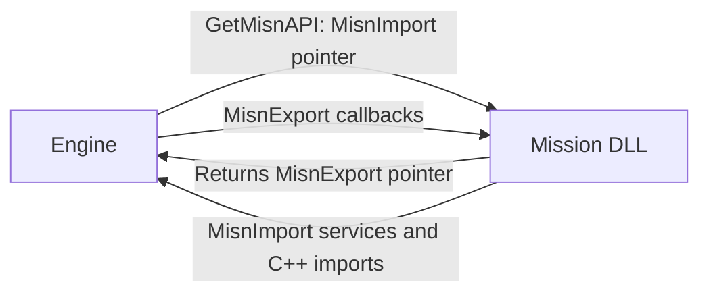

# Mission DLL ABI: public 2.0.185

This reference describes the binary boundary between the installed public
2.0.185 executable and a mission DLL. It adds exact x86 table layouts,
compiler-checked symbol cross-references, and the distinction between table
callbacks, imported functions, and source-only helpers. It does not replace
the [public185 port status](../PORT_2.0.185.md),
[native command input ABI guard](../DEVELOPMENT.md#native-command-abi), or
[IFace reference](../IFACE_REFERENCE.md).

Reviewed **2026-10-27**. **SDK** means an installed-header declaration;
**compile** means a compile-only x86 layout or symbol check; **REA** means a
static observation from the named artifact; **inference** identifies a
comparison rather than observed engine execution. Local binaries, SDK files,
compiler objects, and decompiler output remain outside this source tree,
following [provenance rules](../PROVENANCE.md).

## Target and source identity

| Input | SHA-256 / identity | Scope |
| --- | --- | --- |
| Installed public executable | `2319fb1cbb3a1d35e8d3ffddb501f8b9518db1c9ebab893d34d7024d8535f426` | Version 2.0.185; PE32 x86; 5,316,976 bytes |
| Installed `Missions/LuaMission.dll` | `b197f15b12901c9d87a0b80a7b775860a15302320cd33f1b09fa2b8683da57db` | PE32 x86; 230,400 bytes |
| Installed `ScriptUtils.h` | `c60cb3bdc8a5e9ff342f1239cc4b197713a621e4640a55b4240ca0f6b77a65f7` | All line numbers prefixed SDK below refer to this file |
| Installed `AiCmds.h` | `47c08cb3e28af73d7f2ec364c5237060ef22a01636a4192ded393bf1567a5690` | Command enum and its transport-width comment |
| Installed import library | `9bd7d475a0ffb3d73c53007b06ed41da64fa64a652ed7cf7a575dced86f18264` | COFF linker-member symbol inventory |
| Separate EXU2 reference header | `b12881fd81b256f1a9913b508e6ee5eeebc3dac42e195504279cd49a34c24ac4` | [Source revision `27d57bb`](https://github.com/VTrider/ExtraUtilities2/blob/27d57bba04c8650d1ca59c6eceabafc82ff80d47/include/ScriptUtils.h); not the installed public SDK |

The on-disk executable has a protected code section. Its export directory
remains useful for linkage checks, but successful parsing does not make its
protected instruction bytes a semantic implementation oracle. Existing
capture identities, rebasing, and the distinction between on-disk and
decrypted carriers are recorded in
[engine capture identity](../iface/SOURCES.md#engine-capture-identity).
The LuaMission function observation below is from the separately hashed DLL;
it is not a claim that the protected main executable was decrypted here.

## Three interfaces behind a mission call

1. `GetMisnAPI` negotiates tables: the engine passes `MisnImport *`, and the
   DLL returns `MisnExport *`. Its SDK declaration has C linkage and
   `DLLAPI`; the inspected LuaMission PE export is the undecorated name
   `GetMisnAPI`.
2. `MisnImport` contains services called by the DLL, plus its `time` field.
   `MisnExport` contains callbacks called by the engine. Their directions
   matter more than the similar names.
3. Other SDK services are ordinary C++ imports from the executable. Their
   exact decorated symbols encode overloads and parameter types. An inline
   SDK helper need not have its own PE export at all.

SDK lines 15 and 419 establish `DLLAPI = __cdecl` and the entry declaration.
This is the x86 ABI. The compile probe verifies 4-byte pointers, `int`,
`long`, `Handle`, `DPID`, and the callback enum types; `bool` is 1 byte.
`Time` and `Dist` are 4-byte floats. `Name` is a mutable character pointer;
`ConstName` is a constant character pointer. References in the prototypes
are references, not by-value copies. The observed 72/80-byte tables are not
portable to a process with 8-byte pointers.

The SDK's `MisnExport.ProcessCommand` callback returns **void**. It must not
be substituted for the separate native input interception callback with a
Boolean handled result. The AL-versus-EAX rule and its actual trampoline
tests remain in the [native command ABI guard](../DEVELOPMENT.md#native-command-abi).

## Exact x86 table layouts

All offsets are byte offsets from the table pointer. Every field in these
three layouts occupies four bytes. **Compile:** 64 static assertions against
the installed header verified the sizes, every field offset, scalar/enum
widths, constants, and the command sentinel using the existing x86 compiler
19.44.35228. No generated code was linked or executed.

### MisnImport: 72 bytes

SDK lines 320–339; one float followed by 17 function pointers. All function
pointers below use `__cdecl`.

| Offset | Field | Prototype or data type | SDK line |
| ---: | --- | --- | ---: |
| `0x00` | `time` | `float` | 321 |
| `0x04` | `FailMission` | `void(Time t, const char* fileName)` | 322 |
| `0x08` | `SucceedMission` | `void(Time t, const char* fileName)` | 323 |
| `0x0c` | `ChangeSide` | `void(void)` | 324 |
| `0x10` | `AddScrap` | `ScrapValue(TeamNum t, ScrapValue v)` | 325 |
| `0x14` | `SetScrap` | `ScrapValue(TeamNum t, ScrapValue v)` | 326 |
| `0x18` | `GetScrap` | `ScrapValue(TeamNum t)` | 327 |
| `0x1c` | `GetMaxScrap` | `ScrapValue(TeamNum t)` | 328 |
| `0x20` | `GetTug` | `Handle(Handle h)` | 329 |
| `0x24` | `HasCargo` | `bool(Handle h)` | 330 |
| `0x28` | `GetDistanceObject` | `Dist(Handle& h1, Handle& h2)` | 331 |
| `0x2c` | `GetDistancePath` | `Dist(Handle& h1, ConstName path, int point)` | 332 |
| `0x30` | `GetDistancePathPtr` | `Dist(Handle& h1, AiPath* path, int point)` | 333 |
| `0x34` | `GetNearestObject` | `Handle(Handle h)` | 334 |
| `0x38` | `GetNearestVehicleObject` | `Handle(Handle h)` | 335 |
| `0x3c` | `GetNearestVehiclePath` | `Handle(ConstName path, int point)` | 336 |
| `0x40` | `GetNearestBuilding` | `Handle(Handle h)` | 337 |
| `0x44` | `GetNearestEnemy` | `Handle(Handle h)` | 338 |

### MisnExport: 80 bytes

SDK lines 344–393; three data/version fields followed by 17 callbacks.
Every callback uses `__cdecl`. The callback slot is named `Update`, even
when a DLL's C++ framework exposes its implementation as `Execute`.

| Offset | Field | Prototype or data type | SDK line |
| ---: | --- | --- | ---: |
| `0x00` | `misnImport` | `MisnImport*` | 345 |
| `0x04` | `version` | `unsigned long` | 346 |
| `0x08` | `VersionModifier` | `unsigned long` | 347 |
| `0x0c` | `InitialSetup` | `void(void)` | 350 |
| `0x10` | `Save` | `bool(bool missionSave)` | 352 |
| `0x14` | `Load` | `bool(bool missionSave)` | 353 |
| `0x18` | `PostLoad` | `bool(bool missionSave)` | 354 |
| `0x1c` | `AddObject` | `void(Handle h)` | 355 |
| `0x20` | `DeleteObject` | `void(Handle h)` | 356 |
| `0x24` | `Update` | `void(void)` | 357 |
| `0x28` | `PostRun` | `void(void)` | 358 |
| `0x2c` | `AddPlayer` | `bool(DPID id, int Team, bool ShouldCreateThem)` | 372 |
| `0x30` | `DeletePlayer` | `void(DPID id)` | 375 |
| `0x34` | `PlayerEjected` | `EjectKillRetCodes(Handle DeadObjectHandle)` | 378 |
| `0x38` | `ObjectKilled` | `EjectKillRetCodes(Handle DeadObjectHandle, Handle KillersHandle)` | 379 |
| `0x3c` | `ObjectSniped` | `EjectKillRetCodes(Handle DeadObjectHandle, Handle KillersHandle)` | 380 |
| `0x40` | `GetNextRandomVehicleODF` | `const char*(int ForTeam)` | 385 |
| `0x44` | `SetWorld` | `void(int nextWorld)` | 386 |
| `0x48` | `ProcessCommand` | `void(unsigned long crc)` | 389 |
| `0x4c` | `SetRandomSeed` | `void(unsigned long seed)` | 392 |

The source comments qualify `AddPlayer`: object creation must follow
`ShouldCreateThem`, otherwise different machines can create incompatible
world state. The field layout itself does not prove callback invocation
order, which worlds invoke each callback, or save/resync lifetime.

### MisnExport2: 20 bytes, internal registration state

SDK lines 395–414 describe this as an engine-internal structure populated
through setter functions. It is not appended to the 80-byte table returned
by `GetMisnAPI`. Its source constructor sets all five entries to null.

| Offset | Field | Callback type | SDK line |
| ---: | --- | --- | ---: |
| `0x00` | `m_pPostTargetChangedCallback` | `PostTargetChangedCallback` | 400 |
| `0x04` | `m_pPreGetInCallback` | `PreGetInCallback` | 401 |
| `0x08` | `m_pPreOrdnanceHitCallback` | `PreOrdnanceHitCallback` | 402 |
| `0x0c` | `m_pPrePickupPowerupCallback` | `PrePickupPowerupCallback` | 403 |
| `0x10` | `m_pPreSnipeCallback` | `PreSnipeCallback` | 404 |

## Entry handshake and constants

**REA:** the inspected LuaMission exports only `GetMisnAPI`, ordinal 1,
at static image address `0x4fc1781c`. Its selected and recovered entries
agree; the reported body is 231 contiguous bytes. It copies 18 dwords
(72 bytes) from its argument into DLL-owned static storage, writes the
pointer to that copy into its result table, writes two version constants,
initializes 17 callback slots, and returns the result-table pointer.

| Result-table offset | Static value or role | Cross-check |
| ---: | --- | --- |
| `0x00` | Pointer to the copied import table | Consistent with SDK `misnImport` |
| `0x04` | `0x4c89322e` | SDK line 23: `LATEST_DLL_VERSION` |
| `0x08` | `0x42414c31` | Compile-checked numeric value of SDK line 31: `'BAL1'` |
| `0x0c`–`0x4c` | 17 callback addresses | Consistent with the 80-byte SDK layout |

The source-to-slot naming is an **inference** from the matching installed
layout. The instruction constants/copy length are static observations. The
decompiler reports overlapping global symbols; this work does not promote
its generic recovered types to a new ABI definition.

The SDK comments say the version magic changes when `MisnExport` changes;
changes to `MisnImport` do not require changing that magic. Its presence is
not a general feature-negotiation bitmap. This inspection did not recover
the engine-side acceptance check or establish whether every loader path
requires the modifier to match.

`BZCC_DEFAULT_TPS = 20` is a source constant at SDK line 13, not a measurement
of a running mission. The installed native declaration at line 1760 is
`void EnableHighTPS(int& newRate)`: it reports the selected rate through an
output reference, rather than a C++ return value. Its exact public export
is `?EnableHighTPS@@YAXAAH@Z`. The comment lists rates 10, 15, 20, 30 and 60
and directs construction-time use. A Lua return-value wrapper is a separate
binding contract. No C++ `GetTPS` declaration was found among the inspected
installed or separate-reference exported declarations.

## Extra callbacks and their contracts

The following typedefs are SDK facts; every callback uses `__cdecl`.

| Callback type | Return and parameters | SDK line |
| --- | --- | ---: |
| `PostTargetChangedCallback` | `void(Handle craft, Handle previousTarget, Handle currentTarget)` | 315 |
| `PreGetInCallback` | `PreGetInReturnCodes(const int curWorld, Handle pilotHandle, Handle emptyCraftHandle)` | 303 |
| `PreOrdnanceHitCallback` | `void(Handle shooterHandle, Handle victimHandle, int ordnanceTeam, const char* pOrdnanceODF)` | 295 |
| `PrePickupPowerupCallback` | `PrePickupPowerupReturnCodes(const int curWorld, Handle me, Handle powerupHandle)` | 310 |
| `PreSnipeCallback` | `PreSnipeReturnCodes(const int curWorld, Handle shooterHandle, Handle victimHandle, int ordnanceTeam, const char* pOrdnanceODF)` | 290 |

In particular, `PreOrdnanceHitCallback` and `PostTargetChangedCallback` do
not take a `curWorld` argument. Adding one from another callback's signature
changes the ABI. `PreOrdnanceHitCallback` is a notification returning void,
not a Boolean damage veto.

**Compile + REA:** all five installed setter prototypes resolve to exact
matching x86 C++ exports. RVAs below are from the recorded on-disk export
directory, calculated relative to image base `0x00400000`; they are not
current process addresses or a claim about decoded function bodies.

| Setter | Corresponding internal offset | Public185 export RVA | SDK line |
| --- | ---: | ---: | ---: |
| `SetPostTargetChangedCallback` | `0x00` | `0x0d2ab9` | 2446 |
| `SetPreGetInCallback` | `0x04` | `0x0d2ae2` | 2418 |
| `SetPreOrdnanceHitCallback` | `0x08` | `0x0d2af7` | 2400 |
| `SetPrePickupPowerupCallback` | `0x0c` | `0x0d2acd` | 2435 |
| `SetPreSnipeCallback` | `0x10` | `0x0d2b0c` | 2378 |

SDK comments specify null for an unwanted subscription and automatic clearing
when the mission DLL unloads. For world-changing actions from the three
world-indexed pre-callbacks, they direct actions to world 0 (lockstep),
normally deferred to the next update. They also warn that an ordnance
shooter's handle can have expired and provide `ordnanceTeam` as a fallback.
The ordnance callback's own comment says its hit coverage is incomplete;
it does not promise every weapon/explosion produces an event. These are SDK
contracts, not a new runtime replay of every event path.

| Enum | Installed public values | SDK line |
| --- | --- | ---: |
| `EjectKillRetCodes` | `DoEjectPilot=0`, `DoRespawnSafest=1`, `DLLHandled=2`, `DoGameOver=3` | 40 |
| `PreSnipeReturnCodes` | `PRESNIPE_KILLPILOT=0`, `PRESNIPE_ONLYBULLETHIT=1` | 67 |
| `PreGetInReturnCodes` | `PREGETIN_DENY=0`, `PREGETIN_ALLOW=1` | 77 |
| `PrePickupPowerupReturnCodes` | `PREPICKUPPOWERUP_DENY=0`, `PREPICKUPPOWERUP_ALLOW=1` | 84 |

## Native exports, helpers, and aliases

The compile probe takes a correctly typed address of every active installed
`DLLEXPORT` declaration and inspects the resulting x86 COFF relocation. This
preserves the compiler's full decorated spelling, including overload and
reference/const distinctions; it does not compare only human-readable names.
Default arguments do not create additional binary parameters.

| Comparison | Result | Boundary |
| --- | --- | --- |
| Active installed declarations | 447 rows / 413 distinct source function names | Source inventory includes overloads; excludes commented declarations |
| Exact emitted symbols present in executable exports | 446 / 447 | Linkage presence, not call reachability or semantic proof |
| Exact emitted symbols present in installed import library | 446 / 447 | Same one documented declaration-only exception |
| LuaMission's named `battlezone2.exe` imports | 430 / 430 match both compiled SDK symbols and executable exports | This DLL's imports, not every engine/Lua API |
| Executable export rows / distinct addresses | 892 / 687 | An export count is not a function count |
| Shared export-address groups | 57 | None contains an exact compiled installed-SDK symbol |

The sole declared function without a matching public export/import-library
symbol is `StoppedPlayback(void)`, exact symbol `?StoppedPlayback@@YA_NXZ`.
SDK line 1082 explicitly annotates it as absent from the library/exports;
it is not an accidentally missing adapter introduced by this work. It is
also absent from the inspected historical private export inventory.

The import library has 892 `__imp_` entries. After removing that import
prefix, 890 spellings match PE exports directly. The remaining two are
ordinary x86 C leading-underscore spellings for GPU preference data exports:
`_AmdPowerXpressRequestHighPerformance` and `_NvOptimusEnablement` correspond
to the PE names without that underscore. This narrow spelling normalization
is separate from C++ decorated-signature comparison.

Eighteen source-only inline helper overloads in SDK lines 431–535 access
`MisnImport` directly. An absent PE export for such a helper is expected.

| Source helper | Import-table field | SDK line |
| --- | --- | ---: |
| `FailMission`, `SucceedMission`, `ChangeSide` | Same-named callback slots | 431, 436, 441 |
| `AddScrap`, `SetScrap`, `GetScrap`, `GetMaxScrap` | Same-named callback slots | 446, 451, 456, 461 |
| `GetTime()` | `time` data field, no call | 466 |
| `GetTug`, `HasCargo` | Same-named callback slots | 475, 482 |
| `GetDistance(Handle&, Handle&)` | `GetDistanceObject` | 489 |
| `GetDistance(Handle&, ConstName, int)` | `GetDistancePath` | 495 |
| `GetDistance(Handle&, AiPath*, int)` | `GetDistancePathPtr` | 501 |
| `GetNearestObject` | `GetNearestObject` | 507 |
| `GetNearestVehicle(Handle)` | `GetNearestVehicleObject` | 513 |
| `GetNearestVehicle(ConstName, int)` | `GetNearestVehiclePath` | 519 |
| `GetNearestBuilding`, `GetNearestEnemy` | Same-named callback slots | 525, 531 |

Four more inline convenience overloads return vectors by calling the
corresponding output-reference imports: `GetPosition(Handle)` (line 750),
`GetFront(Handle)` (764), `GetLookFront(Handle)` (2715), and
`GetPosition(Name, int)` (2724). Their source-level return signatures must
not be invented as separately exported functions. Similarly, an export
address shared by unrelated support-library symbols does not make those
functions interchangeable.

## Version boundaries

The separate pinned EXU2 header has 532 exported declaration rows / 489
source function names. Its `MisnImport` and `MisnExport` field declarations
match the installed tables, and it carries the same version magic,
modifier, and default TPS. Its internal `MisnExport2` declares nine pointer
slots instead of five: the first five retain their order, followed by
chat, bullet-init, pre-damage, and post-pickup subscriptions. A 36-byte x86
layout is inferred from those declarations; the compile-only layout check
above applies to the installed 20-byte structure.

Matching the main table magic therefore does **not** imply that the four
extra setter imports exist in public185.

| Separate-reference declaration | Installed header / public185 export | Historical private inventory | Reference line |
| --- | --- | --- | ---: |
| `SetPostBulletInitCallback` | Absent / absent | Name present | 2454 |
| `SetPreDamageCallback` | Absent / absent | Name present | 2465 |
| `SetPostPickupPowerupCallback` | Absent / absent | Name present | 2550 |
| `SetChatMessageSentCallback` | Absent / absent | Name present | 2973 |
| `GetGameVersion` | Absent / absent | Name present | 2908 |
| `GetLockstepTurn` | Absent / absent | Name present | 2963 |

The latter comparison is explicitly **name-only** against a previously
recorded private inventory; it is not a newly opened private executable or
an exact compiled ABI guarantee for that header. The reference header also
adds `DoEjectRatio=4` to `EjectKillRetCodes`; that value is absent from the
installed public header. Do not transfer callback enum values from a guide
or another build without checking the target contract.

IFace's separate API/version matrix remains in
[SDK version availability](../iface/SDK.md#version-availability). The
[public185 port report](../PORT_2.0.185.md) owns adapter/gameplay status.
The fact that a mission DLL's imports resolve does not establish map
serialization compatibility: a map can fail before the DLL loads, as
documented in [map serialization compatibility](../GBD_PUBLIC185_PORT.md).

## Command enum and transport width

SDK `AiCmds.h` line 4 enumerates 54 commands with consecutive values
`CMD_NONE=0` through `CMD_CMDPANEL_DESELECT=53`; `NUM_CMD=54` is the sentinel.
The compile probe confirms `sizeof(AiCommand)=4` for this compiler. The
header's separate network comment requires command values to remain within
one byte. The C++ enum's storage size and the wire representation are thus
different facts; this header alone does not specify a whole network packet.

| Value range | Ordered command names, with `CMD_` prefix omitted |
| --- | --- |
| 0–8 | NONE, SELECT, STOP, GO, ATTACK, FOLLOW, FORMATION, PICKUP, DROPOFF |
| 9–16 | UNDEPLOY, DEPLOY, NO_DEPLOY, GET_REPAIR, GET_RELOAD, GET_WEAPON, GET_CAMERA, GET_BOMB |
| 17–24 | DEFEND, RESCUE, RECYCLE, SCAVENGE, HUNT, BUILD, PATROL, STAGE |
| 25–32 | SEND, GET_IN, LAY_MINES, LOOK_AT, SERVICE, UPGRADE, DEMOLISH, POWER |
| 33–40 | BACK, DONE, CANCEL, SET_GROUP, SET_TEAM, SEND_GROUP, TARGET, INSPECT |
| 41–46 | SWITCHTEAM, INTERFACE, LOGOFF, AUTOPILOT, MESSAGE, CLOSE |
| 47–53 | MORPH_SETDEPLOYED, MORPH_SETUNDEPLOYED, MORPH_UNLOCK, BAILOUT, BUILD_ROTATE, CMDPANEL_SELECT, CMDPANEL_DESELECT |

## Evidence and remaining gaps

The local reproducible analysis is `_BZ_REA/tools/analyze_mission_abi.py`;
its full source hashes, 447 exact symbol cross-references, compiled offsets,
enum values, library spellings, and limitations are retained in
`_BZ_REA/evidence/deep/mission-abi.json`. Temporary compiler sources/objects
are discarded. This public document contains original interface-reference
prose and tables, not imported SDK files or decompiler output.

| Local REA record | Evidence ID | Use |
| --- | --- | --- |
| `exe-exports.json` | `ev_44a0b3cbd1500d076ae98073eddd3a47aec23bccadd5053e684ee6fb6fb06218` | Main executable PE export names, addresses, and artifact hash |
| `luamission-imports.json` | `ev_d5f64f4da9aefb05d6395fe9ea88f452832ba339bdb8139f35f88da06b22669e` | The DLL's exact engine import spellings |
| `luamission-exports.json` | `ev_a74299fb145f518eef85de35f42fdb5516f42bfd2273062ace9f6667de0f513c` | `GetMisnAPI` export and DLL hash |
| `mission-api-function.json` | `ev_e379898c71008d95b5e3e7948e6d83a5a2005aac2e5e6c31afd328c1f2eb2985` | Entry-aligned static copy length and table/version initialization |

The historical public export inventory has SHA-256
`b7023293a55645cfa24241e92af9ea7555e79871e4311e76fa109468a800768a`;
its complete symbol set and RVAs match the current on-disk PE export
directory. The historical private inventory has SHA-256
`c2ca82e6eca7c13cb6dde89840b745186225304dc2172a0f6ccf8e97ceb08519`.
Its previous source/capture context belongs to
[the existing evidence reference](../iface/SOURCES.md).

Open gaps are the engine-side table/version acceptance policy, writes that
refresh the returned `MisnImport.time`, full callback invocation order and
world/save/resync lifetime, handling of malformed/null tables, and event
coverage in real missions. Compile success, symbol presence, and a static
handshake interpretation do not answer those runtime questions. This work
did not start, attach to, or modify a game process.
